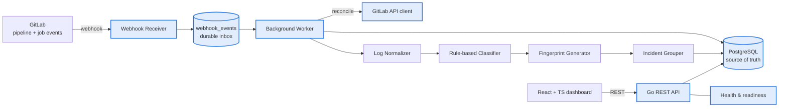

# PipelineSherlock

**CI Failure Intelligence for GitLab** — turn noisy GitLab CI failures into
searchable, explainable failure incidents. The differentiator is **deterministic
fingerprinting and evidence-backed diagnosis**, not a chat interface that guesses
at root causes.

> Status: **Milestone 0 complete; Milestone 1 (GitLab ingestion) complete;
> Milestone 2 (failure analysis) complete; Milestone 3 (incidents & grouping)
> complete — the read path that lists a project's incidents (slice 1) and the
> incident detail view with occurrence history and heuristic flaky/regression
> signals (slice 2).** This is an early-stage portfolio project, not a
> production system. See [PROJECT_STATUS.md](PROJECT_STATUS.md) for exactly
> what is built and what is next.

---

## Problem

Large engineering teams repeatedly investigate similar pipeline failures. Logs
are long, failures recur across branches, flaky tests create noise, and teams
lose the historical context needed to identify regressions quickly.
PipelineSherlock ingests GitLab pipeline/job events, normalizes and classifies
the failures deterministically, fingerprints them, and groups recurrences into
incidents with the evidence attached.

## Architecture at a glance

The full system (shaded = built so far):



**Every mechanism we implement has a workflow diagram with a walkthrough in
[docs/architecture.md](docs/architecture.md)** — system data flow, the Milestone 0
component view, startup/shutdown sequence, config load-and-validate, the
health/readiness request lifecycle, the database migration flow, the failure
analysis engine, the fingerprint persistence path, and the incident read path.
Design decisions and their trade-offs are in the [ADRs](docs/adr/).

## Tech stack

Go 1.27 (std-lib `net/http` router, `log/slog`) · PostgreSQL 16 via `pgx/v5` ·
optional Redis · React + TypeScript (Vite) · Docker Compose · GitHub Actions CI.
Rationale: [ADR 0003](docs/adr/0003-tech-stack.md).

## Quick start (one command)

Prerequisites: **Go 1.27+**, **Docker + Docker Compose**, and (for the UI)
**Node 22+**.

```bash
cp .env.example .env     # local-only defaults, safe to use as-is
make dev                 # start Postgres + Redis, run migrations, serve the API
```

Then:

```bash
curl -s localhost:8080/healthz   # liveness  -> {"status":"ok"}
curl -s localhost:8080/readyz    # readiness -> {"status":"ok","checks":{"database":"ok"}}
```

Load the demo dataset (requires `psql`):

```bash
make seed
```

### Common tasks

```bash
make test         # unit tests
make test-race    # unit tests with the race detector (CI; needs 64-bit cgo)
make migrate      # apply pending migrations
make migrate-down # revert the most recent migration
make fmt vet      # format + static analysis
make help         # list all targets
```

> **Note on `-race` locally:** the race detector needs 64-bit cgo. On a machine
> whose gcc is 32-bit only, `make test-race` fails to compile — use `make test`
> locally; CI runs the race detector on Linux.

## Frontend

A minimal Vite + React + TypeScript app lives in [`web/`](web/) and shows the
backend health status.

```bash
cd web && npm install && npm run dev
```

## Repository layout

```
cmd/server/            # entry point: wiring + lifecycle (+ background worker)
internal/
  config/              # env config, fail-fast validation
  domain/              # core entities + invariants (Project, Pipeline, Job, WebhookEvent)
  analysis/            # pure failure analysis: normalize, classify, fingerprint
  application/         # use cases + ports (register, ingest, process, worker)
  adapters/gitlab/     # GitLab REST client (pagination, retries, timeouts)
  adapters/postgres/   # repository implementations (projects, inbox, pipelines)
  platform/postgres/   # pgx pool + embedded migrator
  transport/http/      # router, middleware, health/readiness, API handlers (incidents)
migrations/            # embedded, reversible SQL migrations
tests/fixtures/        # deterministic demo/seed data
docs/                  # architecture.md (diagrams) + adr/
web/                   # React + TypeScript dashboard
```

## Security & limitations (current)

- Secrets are never logged: config logging is redacted; access logs exclude
  bodies, headers and query strings.
- Readiness never echoes raw dependency errors.
- Namespaces reject path-traversal segments (`.`/`..`).
- Webhook tokens are stored as SHA-256 hashes and verified in constant time; the
  plaintext secret is shown only once at registration.
- **Built (M1 slice 1):** project registration + webhook secret, the GitLab
  webhook endpoint with token validation, and a durable, de-duplicated event
  inbox. See the diagrams in [docs/architecture.md](docs/architecture.md) §7–§8.
- **Built (M1 slice 2):** a background worker that claims inbox events
  (`FOR UPDATE SKIP LOCKED`), reconciles pipeline/job state against the GitLab
  API when a token is configured (falling back to the webhook payload),
  idempotently upserts `pipelines`/`jobs`, and bounds retries with requeue/fail.
  The GitLab REST client handles pagination, per-request timeouts and retries
  with jitter. See [docs/architecture.md](docs/architecture.md) §9–§10.
- **Built (M2 slice 1):** the deterministic failure-analysis engine — log
  normalization, a priority-ordered rule-based classifier, and stable
  SHA-256 fingerprinting (`internal/analysis`), plus GitLab job *trace*
  fetching. Pure and fully unit-tested. See
  [docs/architecture.md](docs/architecture.md) §11.
- **Built (M2 slice 2):** the worker fingerprints each failed job (fetch trace →
  analyse → persist) into `failure_fingerprints` / `failure_occurrences`, with
  idempotent, de-duplicated occurrence counting (unique `(job_id,
  fingerprint_id)`; count bumped only on a new occurrence). Best-effort, so a
  trace error never fails the event. Fingerprinting requires a GitLab token (it
  needs job logs). See [docs/architecture.md](docs/architecture.md) §12.
- **Built (M3 slice 1):** the incident read path —
  `GET /api/v1/projects/{gitlab_project_id}/incidents` resolves the GitLab id to
  the registered project (clean 404 if unknown), then lists its fingerprints as
  incidents (one per fingerprint, most-recently-seen first) with a clamped limit
  (default 50, max 200). Each incident carries its category, normalized
  signature and occurrence/first-seen/last-seen aggregates. See
  [docs/architecture.md](docs/architecture.md) §13.
- **Built (M3 slice 2):** the incident detail view —
  `GET /api/v1/projects/{gitlab_project_id}/incidents/{fingerprint}` returns the
  incident with its occurrence history (each joined to its job and pipeline for
  ref, sha, stage and GitLab ids), a per-ref breakdown, and two deterministic
  heuristic signals: `flaky_suspected` (same commit failed in more than one run)
  and `regression_suspected` (failure recurs across multiple commits). The
  signal logic is a pure, fully unit-tested domain function and is framed as
  *candidates for review*, not verdicts. See
  [docs/architecture.md](docs/architecture.md) §14.
- **Not yet built:** richer flaky/regression detection using success data and
  timing, the dashboard beyond a health view, GitLab MR write-back, auth/RBAC,
  and any benchmark claims. No performance or scale numbers are claimed.

## License

MIT (see `LICENSE`, to be added).
