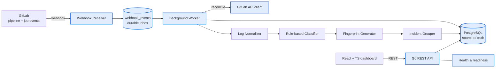

# PipelineSherlock

**CI Failure Intelligence for GitLab** — turn noisy GitLab CI failures into
searchable, explainable failure incidents. The differentiator is **deterministic
fingerprinting and evidence-backed diagnosis**, not a chat interface that guesses
at root causes.

> Status: **Milestones 0–5 complete — Milestone 5 (GitLab MR write-back) now
> posts an incident diagnosis back to the merge request a failing pipeline
> belongs to: a deterministic Markdown comment, idempotent per incident+MR, and
> opt-in via `GITLAB_WRITEBACK_ENABLED` (slice 1 built the engine, slice 2 wired
> it into the worker).** Earlier milestones: GitLab ingestion (M1), the
> deterministic failure-analysis engine (M2), incidents with occurrence history
> and heuristic flaky/regression signals (M3), and a React + TypeScript
> dashboard that lists incidents and drills into an incident's detail (M4). This
> is an early-stage portfolio project, not a production system. See
> [PROJECT_STATUS.md](PROJECT_STATUS.md) for exactly what is built and what is
> next.

---

## Problem

Large engineering teams repeatedly investigate similar pipeline failures. Logs
are long, failures recur across branches, flaky tests create noise, and teams
lose the historical context needed to identify regressions quickly.
PipelineSherlock ingests GitLab pipeline/job events, normalizes and classifies
the failures deterministically, fingerprints them, and groups recurrences into
incidents with the evidence attached.

## Architecture at a glance

The full system (shaded = built so far):



**Every mechanism we implement has a workflow diagram with a walkthrough in
[docs/architecture.md](docs/architecture.md)** — system data flow, the Milestone 0
component view, startup/shutdown sequence, config load-and-validate, the
health/readiness request lifecycle, the database migration flow, the failure
analysis engine, the fingerprint persistence path, and the incident read path.
Design decisions and their trade-offs are in the [ADRs](docs/adr/).

## Tech stack

Go 1.27 (std-lib `net/http` router, `log/slog`) · PostgreSQL 16 via `pgx/v5` ·
optional Redis · React + TypeScript (Vite) · Docker Compose · GitHub Actions CI.
Rationale: [ADR 0003](docs/adr/0003-tech-stack.md).

## Quick start (one command)

Prerequisites: **Go 1.27+**, **Docker + Docker Compose**, and (for the UI)
**Node 22+**.

```bash
cp .env.example .env     # local-only defaults, safe to use as-is
make dev                 # start Postgres + Redis, run migrations, serve the API
```

Then:

```bash
curl -s localhost:8080/healthz   # liveness  -> {"status":"ok"}
curl -s localhost:8080/readyz    # readiness -> {"status":"ok","checks":{"database":"ok"}}
```

Load the demo dataset (requires `psql`):

```bash
make seed
```

### Common tasks

```bash
make test         # unit tests
make test-race    # unit tests with the race detector (CI; needs 64-bit cgo)
make migrate      # apply pending migrations
make migrate-down # revert the most recent migration
make fmt vet      # format + static analysis
make help         # list all targets
```

> **Note on `-race` locally:** the race detector needs 64-bit cgo. On a machine
> whose gcc is 32-bit only, `make test-race` fails to compile — use `make test`
> locally; CI runs the race detector on Linux.

## Frontend

A Vite + React + TypeScript dashboard lives in [`web/`](web/). It lists a
registered GitLab project's failure incidents from the read API (enter the
project id and load), drills into an incident's occurrence history and
heuristic signals, and shows the backend health status.

```bash
cd web && npm install && npm run dev
```

```bash
npm test          # Vitest unit/component tests (also run in CI)
npm run coverage  # tests with a coverage report
npm run build     # type-check + production build
```

The dev server proxies `/api`, `/healthz` and `/readyz` to the Go backend on
`localhost:8080`, so run the backend (`make dev`) alongside it.

## Repository layout

```
cmd/server/            # entry point: wiring + lifecycle (+ background worker)
internal/
  config/              # env config, fail-fast validation
  domain/              # core entities + invariants (Project, Pipeline, Job, WebhookEvent)
  analysis/            # pure failure analysis: normalize, classify, fingerprint
  application/         # use cases + ports (register, ingest, process, worker)
  adapters/gitlab/     # GitLab REST client (pagination, retries, timeouts)
  adapters/postgres/   # repository implementations (projects, inbox, pipelines)
  platform/postgres/   # pgx pool + embedded migrator
  transport/http/      # router, middleware, health/readiness, API handlers (incidents)
migrations/            # embedded, reversible SQL migrations
tests/fixtures/        # deterministic demo/seed data
docs/                  # architecture.md (diagrams) + adr/
web/                   # React + TypeScript dashboard (incidents list + detail + health)
```

## Security & limitations (current)

- Secrets are never logged: config logging is redacted; access logs exclude
  bodies, headers and query strings.
- Readiness never echoes raw dependency errors.
- Namespaces reject path-traversal segments (`.`/`..`).
- Webhook tokens are stored as SHA-256 hashes and verified in constant time; the
  plaintext secret is shown only once at registration.
- **Built (M1 slice 1):** project registration + webhook secret, the GitLab
  webhook endpoint with token validation, and a durable, de-duplicated event
  inbox. See the diagrams in [docs/architecture.md](docs/architecture.md) §7–§8.
- **Built (M1 slice 2):** a background worker that claims inbox events
  (`FOR UPDATE SKIP LOCKED`), reconciles pipeline/job state against the GitLab
  API when a token is configured (falling back to the webhook payload),
  idempotently upserts `pipelines`/`jobs`, and bounds retries with requeue/fail.
  The GitLab REST client handles pagination, per-request timeouts and retries
  with jitter. See [docs/architecture.md](docs/architecture.md) §9–§10.
- **Built (M2 slice 1):** the deterministic failure-analysis engine — log
  normalization, a priority-ordered rule-based classifier, and stable
  SHA-256 fingerprinting (`internal/analysis`), plus GitLab job *trace*
  fetching. Pure and fully unit-tested. See
  [docs/architecture.md](docs/architecture.md) §11.
- **Built (M2 slice 2):** the worker fingerprints each failed job (fetch trace →
  analyse → persist) into `failure_fingerprints` / `failure_occurrences`, with
  idempotent, de-duplicated occurrence counting (unique `(job_id,
  fingerprint_id)`; count bumped only on a new occurrence). Best-effort, so a
  trace error never fails the event. Fingerprinting requires a GitLab token (it
  needs job logs). See [docs/architecture.md](docs/architecture.md) §12.
- **Built (M3 slice 1):** the incident read path —
  `GET /api/v1/projects/{gitlab_project_id}/incidents` resolves the GitLab id to
  the registered project (clean 404 if unknown), then lists its fingerprints as
  incidents (one per fingerprint, most-recently-seen first) with a clamped limit
  (default 50, max 200). Each incident carries its category, normalized
  signature and occurrence/first-seen/last-seen aggregates. See
  [docs/architecture.md](docs/architecture.md) §13.
- **Built (M3 slice 2):** the incident detail view —
  `GET /api/v1/projects/{gitlab_project_id}/incidents/{fingerprint}` returns the
  incident with its occurrence history (each joined to its job and pipeline for
  ref, sha, stage and GitLab ids), a per-ref breakdown, and two deterministic
  heuristic signals: `flaky_suspected` (same commit failed in more than one run)
  and `regression_suspected` (failure recurs across multiple commits). The
  signal logic is a pure, fully unit-tested domain function and is framed as
  *candidates for review*, not verdicts. See
  [docs/architecture.md](docs/architecture.md) §14.
- **Built (M4 slice 1):** a React + TypeScript dashboard that lists a project's
  incidents from the read API — a typed client with boundary validation
  (`parseIncidents`), a container with explicit loading/error/empty/data states
  (in-flight fetches cancelled via `AbortController`), and a presentational
  `IncidentsTable`. Vitest + Testing Library cover the client, parser and view;
  the suite runs in CI. See [docs/architecture.md](docs/architecture.md) §15.
- **Built (M4 slice 2):** the incident detail drill-down — clicking a row loads
  `GET /…/incidents/{fingerprint}` and shows the occurrence history (ref, sha,
  job, stage, pipeline), a per-ref breakdown, and the flaky/regression signals
  (framed as candidates for review). A second container owns the detail load;
  back returns to the list without refetching. See
  [docs/architecture.md](docs/architecture.md) §16.
- **Built (M5 slice 1):** the GitLab merge-request write-back engine — a
  `Comment` domain entity, an idempotent `comments` store (unique on
  `(fingerprint_id, merge_request_iid)`, migration 0005), a GitLab
  `PostMergeRequestNote` client method, and a `WriteBackService` use case that
  enqueues → posts → marks posted/failed exactly once per incident+MR. The
  comment body is a pure, deterministic Markdown function. Fully unit-tested.
  See [docs/architecture.md](docs/architecture.md) §17.
- **Built (M5 slice 2):** write-back wired into the worker — the pipeline webhook
  parser now extracts `merge_request.iid`, `RecordOccurrence` returns the
  fingerprint id + running count + new-occurrence flag, and the processor posts
  the diagnosis (opt-in via `GITLAB_WRITEBACK_ENABLED`, and only with a GitLab
  token) once per incident+MR. Best-effort — a post failure never fails the
  event. See [docs/architecture.md](docs/architecture.md) §18.
- **Built (M6 slice 1):** API-key authentication — every `/api/v1` data route now
  requires an `Authorization: Bearer <key>` whose SHA-256 hash matches a stored
  key (`api_keys`, migration 0006), verified in the transport `authMiddleware`
  (401 + `WWW-Authenticate` otherwise). Health probes and the GitLab webhook (its
  own per-project token) stay public; the surface fails closed. Mint a key with
  `server issue-key <name>` (plaintext shown once). This is slice 1 of the
  [production-readiness roadmap](docs/production-readiness-roadmap.md); see
  [docs/architecture.md](docs/architecture.md) §19.
- **Not yet built:** per-caller authorization scoping (M6 slice 2) and the rest
  of the [production-readiness roadmap](docs/production-readiness-roadmap.md),
  dashboard authentication (M14), deep-linkable incident selection (URL state),
  richer flaky/regression detection using success data and timing, and any
  benchmark claims. No performance or scale numbers are claimed.

## License

MIT (see `LICENSE`, to be added).
