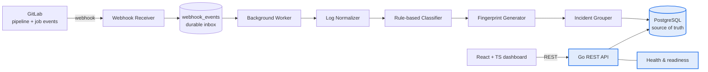

# PipelineSherlock

**CI Failure Intelligence for GitLab** — turn noisy GitLab CI failures into
searchable, explainable failure incidents. The differentiator is **deterministic
fingerprinting and evidence-backed diagnosis**, not a chat interface that guesses
at root causes.

> Status: **Milestone 0 (Foundation) complete.** This is an early-stage portfolio
> project, not a production system. See [PROJECT_STATUS.md](PROJECT_STATUS.md) for
> exactly what is built and what is next.

---

## Problem

Large engineering teams repeatedly investigate similar pipeline failures. Logs
are long, failures recur across branches, flaky tests create noise, and teams
lose the historical context needed to identify regressions quickly.
PipelineSherlock ingests GitLab pipeline/job events, normalizes and classifies
the failures deterministically, fingerprints them, and groups recurrences into
incidents with the evidence attached.

## Architecture at a glance

The full system (shaded = built in Milestone 0):



**Every mechanism we implement has a workflow diagram with a walkthrough in
[docs/architecture.md](docs/architecture.md)** — system data flow, the Milestone 0
component view, startup/shutdown sequence, config load-and-validate, the
health/readiness request lifecycle, and the database migration flow. Design
decisions and their trade-offs are in the [ADRs](docs/adr/).

## Tech stack

Go 1.27 (std-lib `net/http` router, `log/slog`) · PostgreSQL 16 via `pgx/v5` ·
optional Redis · React + TypeScript (Vite) · Docker Compose · GitHub Actions CI.
Rationale: [ADR 0003](docs/adr/0003-tech-stack.md).

## Quick start (one command)

Prerequisites: **Go 1.27+**, **Docker + Docker Compose**, and (for the UI)
**Node 22+**.

```bash
cp .env.example .env     # local-only defaults, safe to use as-is
make dev                 # start Postgres + Redis, run migrations, serve the API
```

Then:

```bash
curl -s localhost:8080/healthz   # liveness  -> {"status":"ok"}
curl -s localhost:8080/readyz    # readiness -> {"status":"ok","checks":{"database":"ok"}}
```

Load the demo dataset (requires `psql`):

```bash
make seed
```

### Common tasks

```bash
make test         # unit tests
make test-race    # unit tests with the race detector (CI; needs 64-bit cgo)
make migrate      # apply pending migrations
make migrate-down # revert the most recent migration
make fmt vet      # format + static analysis
make help         # list all targets
```

> **Note on `-race` locally:** the race detector needs 64-bit cgo. On a machine
> whose gcc is 32-bit only, `make test-race` fails to compile — use `make test`
> locally; CI runs the race detector on Linux.

## Frontend

A minimal Vite + React + TypeScript app lives in [`web/`](web/) and shows the
backend health status.

```bash
cd web && npm install && npm run dev
```

## Repository layout

```
cmd/server/            # entry point: wiring + lifecycle
internal/
  config/              # env config, fail-fast validation
  domain/              # core entities + invariants (Project)
  platform/postgres/   # pgx pool + embedded migrator (adapter)
  transport/http/      # router, middleware, health/readiness
migrations/            # embedded, reversible SQL migrations
tests/fixtures/        # deterministic demo/seed data
docs/                  # architecture.md (diagrams) + adr/
web/                   # React + TypeScript dashboard
```

## Security & limitations (current)

- Secrets are never logged: config logging is redacted; access logs exclude
  bodies, headers and query strings.
- Readiness never echoes raw dependency errors.
- Namespaces reject path-traversal segments (`.`/`..`).
- **Not yet built:** GitLab ingestion, log classification, fingerprinting, the
  dashboard beyond a health view, auth, and any benchmark claims. No performance
  or scale numbers are claimed.

## License

MIT (see `LICENSE`, to be added).
