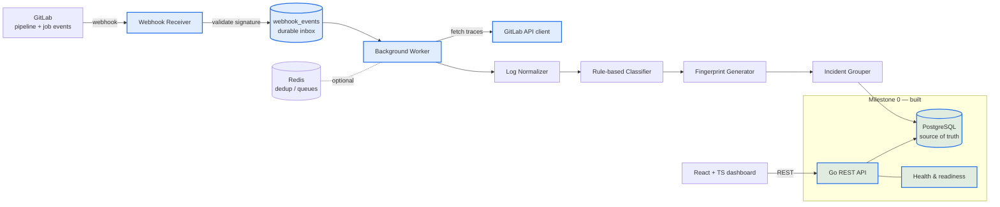
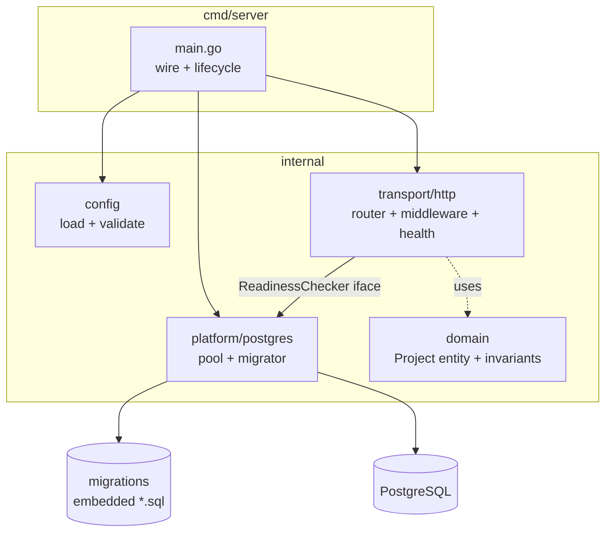
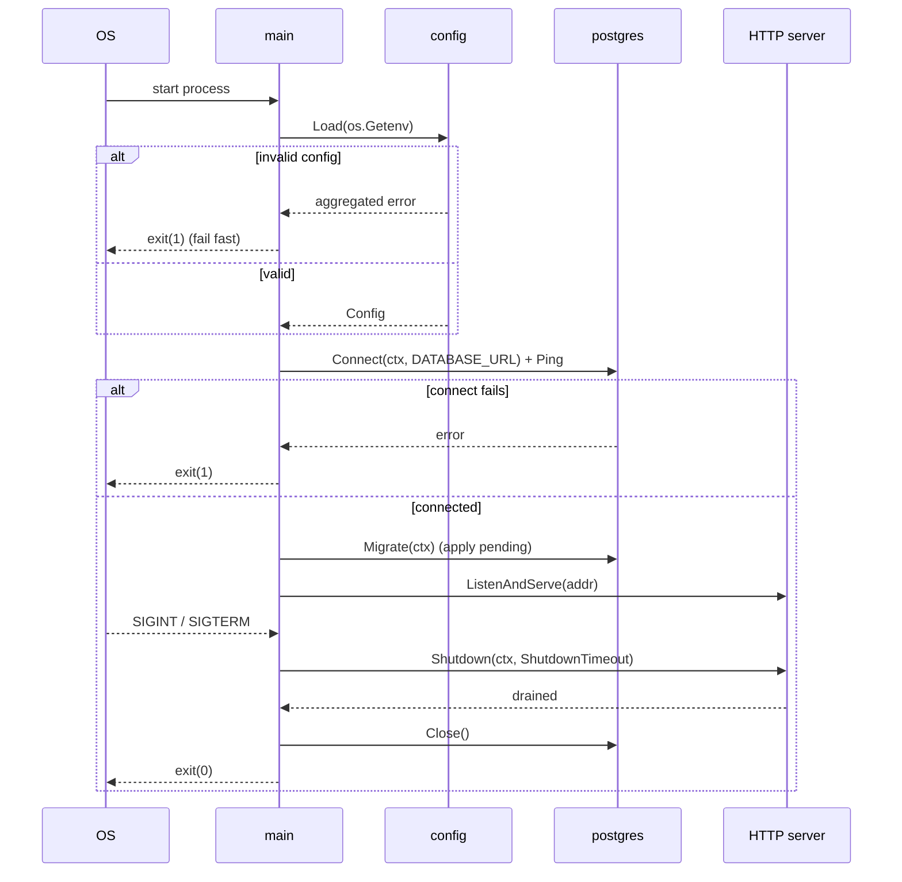
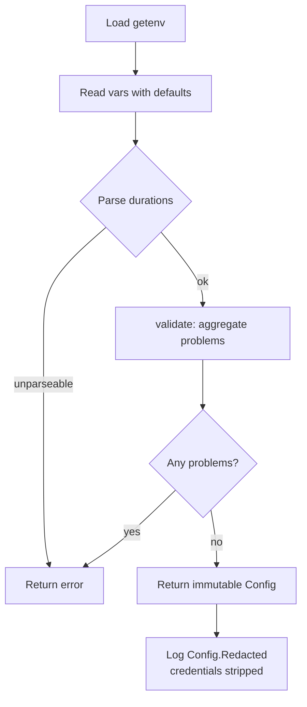
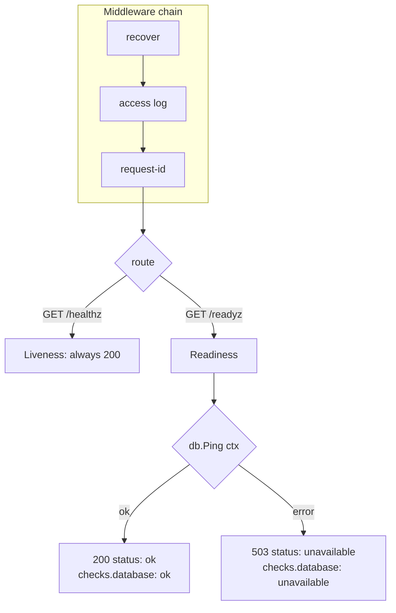
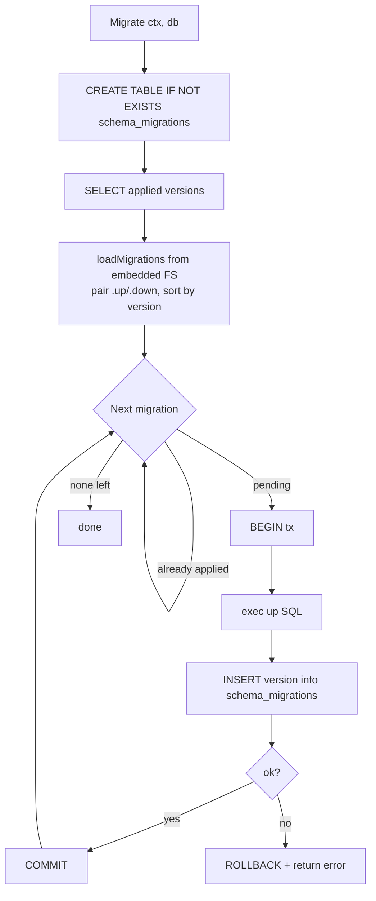
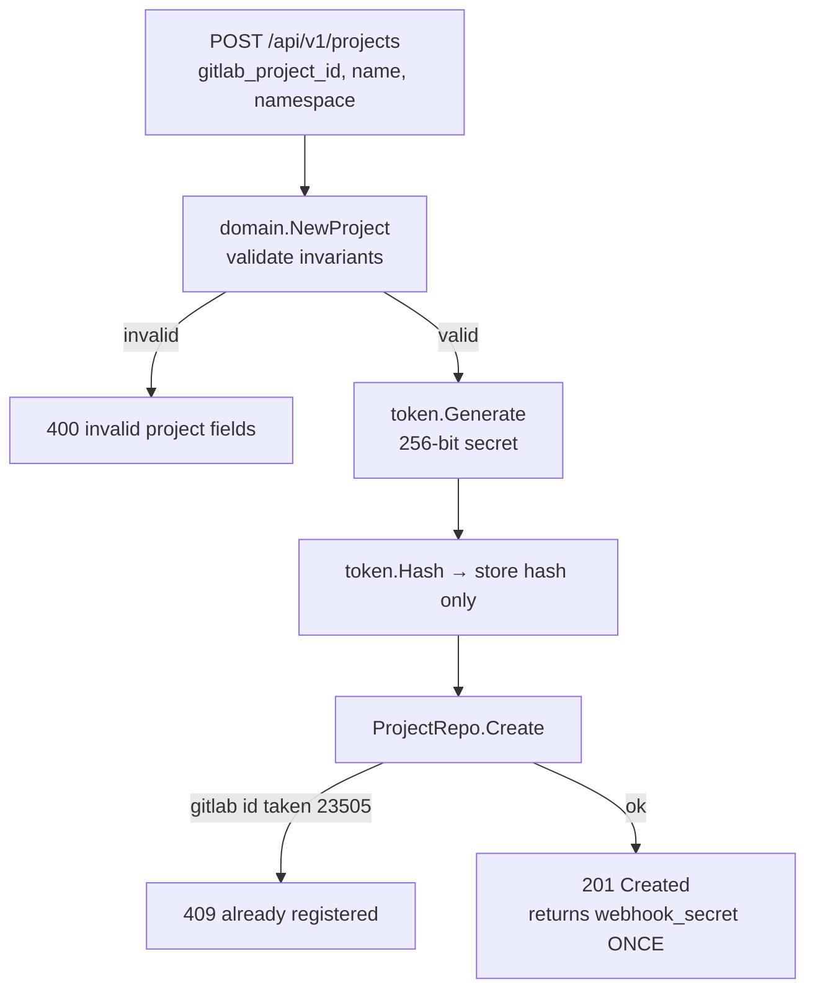
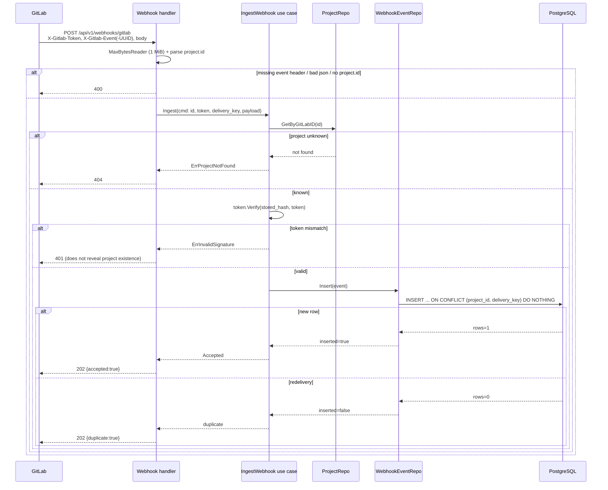
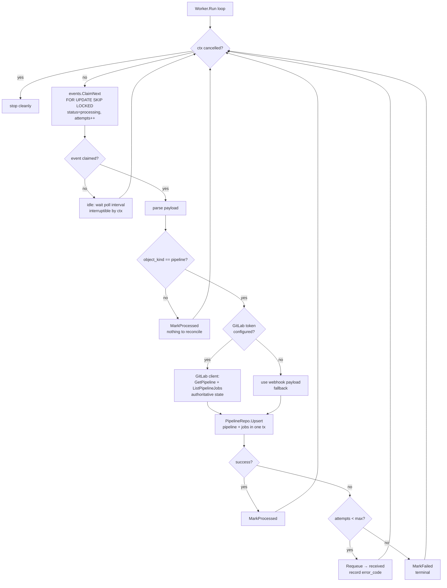
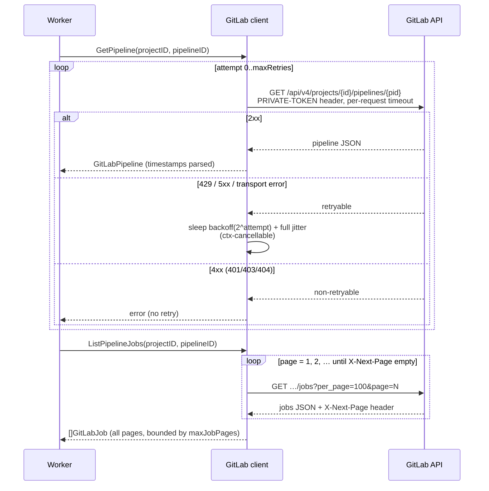

# PipelineSherlock — Architecture

This document explains how PipelineSherlock is put together and, for every
mechanism we implement, gives a workflow diagram with a short walkthrough.
Diagrams use [Mermaid](https://mermaid.js.org/) and render directly on GitHub.

Each diagram is labelled **[Built: M0]** (implemented in Milestone 0) or
**[Planned]** (part of the target design, not yet built). This keeps the
document honest about what exists today versus the roadmap.

---

## 1. System context and end-to-end data flow **[Planned target, M0 subset built]**

The target system turns noisy GitLab CI failures into searchable, deterministic
failure incidents. The diagram below is the whole pipeline; the shaded path is
what Milestone 0 establishes (configuration, HTTP surface, database, health).

> Shaded nodes are built as of M1 slice 2: the HTTP/DB spine (M0), the webhook
> receiver and durable inbox (M1 slice 1), and the background worker plus GitLab
> API client (M1 slice 2). The normalize → classify → fingerprint → group
> analysis stages remain planned.

**Walkthrough.** GitLab sends pipeline/job events to a webhook receiver, which
validates them and writes them to a durable inbox (`webhook_events`) before
acknowledging — so acknowledgement is fast and processing can be retried safely.
A background worker pulls from the inbox, fetches job traces via the GitLab API,
normalizes the logs, classifies the failure, generates a deterministic
fingerprint, and groups recurring failures into incidents. PostgreSQL is the
source of truth; Redis is optional and only used where it earns its place. The
React dashboard reads everything through the Go REST API. **Milestone 0 builds
the spine of this picture: configuration, the HTTP service, the database and the
health/readiness surface** — the ingestion and analysis stages arrive in later
milestones.

---

## 2. Milestone 0 component view **[Built: M0]**

**Walkthrough.** `main.go` is the only place that wires concrete types together.
`config` is loaded and validated first. The `postgres` adapter owns the
connection pool and the embedded migrator. The `transport/http` layer depends on
the database only through the small `ReadinessChecker` interface it defines
itself (`Ping(ctx) error`), so the transport layer never imports the Postgres
package directly — this is the ports-and-adapters boundary that keeps business
logic independent of infrastructure. The `domain` package holds entities and
rules and imports nothing from the outer layers.

---

## 3. Startup and graceful shutdown sequence **[Built: M0]**

**Walkthrough.** Startup is strictly ordered and fails fast: bad configuration
or an unreachable database stops the process with a non-zero exit before any
traffic is served. On `serve`, pending migrations are applied, then the HTTP
server starts. A SIGINT/SIGTERM triggers a bounded graceful shutdown
(`ShutdownTimeout`) that drains in-flight requests before closing the pool.

---

## 4. Configuration load-and-validate flow **[Built: M0]**

**Walkthrough.** Configuration is read once through an injectable `getenv`
function (so tests never touch the real environment). Every problem — a missing
`DATABASE_URL`, an unparseable duration — is aggregated so one run reports all of
them. Only a fully valid, immutable `Config` is returned. Startup logging uses
`Config.Redacted()`, which strips credentials from connection strings so secrets
never reach the logs.

---

## 5. Health vs readiness request lifecycle **[Built: M0]**

**Walkthrough.** Every request passes through panic recovery, structured access
logging (method, path, status, duration, request id — never bodies or headers,
which may carry secrets) and request-id assignment. `/healthz` is liveness: it
always returns 200 so a failing liveness probe means "restart me", not "a
dependency is down". `/readyz` is readiness: it pings the database and returns
503 when the dependency is unavailable, so load balancers stop routing to the
instance. Readiness never echoes the raw dependency error (which can carry host
or credential detail) — only a coarse `ok` / `unavailable` marker.

---

## 6. Database migration flow **[Built: M0]**

**Walkthrough.** Migrations are embedded in the binary. The migrator ensures a
`schema_migrations` ledger, reads the already-applied versions, and applies each
pending `*.up.sql` in version order. Each migration and its ledger insert run in
a **single transaction**, so a failure leaves the schema untouched and the run
can be retried. `rollback` applies the matching `*.down.sql` for the latest
applied version. This small in-house migrator is a deliberate Milestone 0
trade-off to keep the dependency surface minimal — see
[ADR 0004](adr/0004-minimal-migrator.md).

---

## 7. Project registration and webhook secret **[Built: M1]**

A project must be registered before PipelineSherlock will accept its webhooks.
Registration mints a per-project secret and stores only its hash.

**Walkthrough.** The handler validates the body, then the domain validates the
project invariants. A high-entropy secret is generated; **only its SHA-256 hash
is persisted** (`projects.webhook_secret_hash`). The plaintext secret is
returned exactly once in the 201 response for the operator to paste into
GitLab's webhook config — it is never stored, logged, or retrievable again, and
`GET /api/v1/projects` never includes it. A duplicate GitLab id maps the unique
violation (SQLSTATE 23505) to a clean 409.

---

## 8. Webhook ingestion: validation + durable inbox + de-duplication **[Built: M1]**

The webhook endpoint authenticates the delivery, writes it to the durable inbox,
and acknowledges fast. Processing is asynchronous (next milestone).

**Walkthrough.** The body is size-bounded before anything is read. The handler
derives a **delivery key** from GitLab's `X-Gitlab-Event-UUID` header, falling
back to a SHA-256 of the body so identical redeliveries still collapse. The use
case looks up the project, verifies the token against the stored hash with a
constant-time compare, and on success writes to the inbox. **De-duplication is
the database's job**: the unique `(project_id, delivery_key)` constraint plus
`ON CONFLICT DO NOTHING` means a redelivered webhook is a no-op — replaying the
same event many times still yields exactly one stored row (202 either way, with
`accepted` vs `duplicate`). The acknowledgement is fast because the event is
only persisted here; fetching traces and classifying happen asynchronously in a
later milestone.

---

## 9. Background worker: draining the inbox and reconciling state **[Built: M1]**

Webhook ingestion (§8) only persists the delivery and acknowledges. The actual
pipeline/job state is reconciled asynchronously by a background worker, so a
slow or unavailable GitLab API never blocks webhook acknowledgement.

**Walkthrough.** The worker runs as a goroutine for the lifetime of the server
and stops on the same shutdown signal. Each iteration **claims** one event with
`ClaimNext`, which issues a single `UPDATE … WHERE id = (SELECT … FOR UPDATE SKIP
LOCKED LIMIT 1)` — the row lock with `SKIP LOCKED` means many workers could run
without ever claiming the same row, and the claim flips the status to
`processing` and increments `attempts` atomically. The payload is parsed; only
`object_kind == "pipeline"` carries pipeline state, so other event kinds are
acknowledged as processed with nothing to do. When a GitLab token is configured
the worker fetches **authoritative** pipeline and job state from the API (the
stored payload can be stale by the time it is processed); otherwise it falls
back to the payload itself. The result is upserted into `pipelines`/`jobs` in a
single transaction, keyed on the GitLab ids so reprocessing converges instead of
duplicating. On success the event is marked `processed`. On failure it is
**requeued** (back to `received`, recording an error code) until the attempt
bound is reached, after which it is **failed** terminally. When the inbox is
empty the worker idles for a short, context-interruptible interval before
polling again, draining eagerly while work remains.

---

## 10. GitLab API client: pagination, timeouts and bounded retries **[Built: M1]**

The worker reads authoritative state through a small GitLab REST client that
owns its own resilience concerns, so the use case stays free of HTTP detail.

**Walkthrough.** Every request carries a `PRIVATE-TOKEN` header and is bounded by
the HTTP client's timeout. On a `429`, a `5xx`, or a transport error the client
retries up to a fixed bound, sleeping an exponentially growing delay with **full
jitter** (so many workers don't retry in lockstep) and honouring context
cancellation during the wait. Client errors such as `401`/`403`/`404` are **not**
retried — they will not fix themselves — and surface immediately. Job listing
follows GitLab's pagination: it requests pages of 100 and follows the
`X-Next-Page` response header until it is empty, with a hard page cap so a
misbehaving server cannot loop forever. Timestamps are parsed from RFC3339 and
durations normalized to whole seconds before the data crosses back into the
application layer as `GitLabPipeline` / `GitLabJob`.

---

## Related documents

- [ADR 0001 — Record architecture decisions](adr/0001-record-architecture-decisions.md)
- [ADR 0002 — Modular monolith](adr/0002-modular-monolith.md)
- [ADR 0003 — Go / React / PostgreSQL stack](adr/0003-tech-stack.md)
- [ADR 0004 — Minimal in-house migrator for M0](adr/0004-minimal-migrator.md)
- [PROJECT_STATUS.md](../PROJECT_STATUS.md) — what is done, what is next
