# PipelineSherlock — Architecture

This document explains how PipelineSherlock is put together and, for every
mechanism we implement, gives a workflow diagram with a short walkthrough.
Diagrams use [Mermaid](https://mermaid.js.org/) and render directly on GitHub.

Each diagram is labelled **[Built: M0]** (implemented in Milestone 0) or
**[Planned]** (part of the target design, not yet built). This keeps the
document honest about what exists today versus the roadmap.

---

## 1. System context and end-to-end data flow **[Planned target, M0 subset built]**

The target system turns noisy GitLab CI failures into searchable, deterministic
failure incidents. The diagram below is the whole pipeline; the shaded path is
what Milestone 0 establishes (configuration, HTTP surface, database, health).

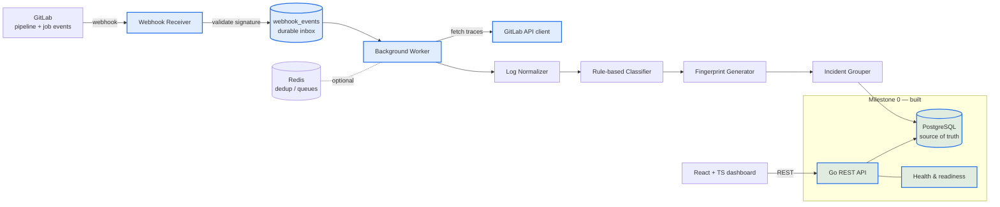

> Shaded nodes are built as of M1 slice 2: the HTTP/DB spine (M0), the webhook
> receiver and durable inbox (M1 slice 1), and the background worker plus GitLab
> API client (M1 slice 2). The normalize → classify → fingerprint → group
> analysis stages remain planned.

**Walkthrough.** GitLab sends pipeline/job events to a webhook receiver, which
validates them and writes them to a durable inbox (`webhook_events`) before
acknowledging — so acknowledgement is fast and processing can be retried safely.
A background worker pulls from the inbox, fetches job traces via the GitLab API,
normalizes the logs, classifies the failure, generates a deterministic
fingerprint, and groups recurring failures into incidents. PostgreSQL is the
source of truth; Redis is optional and only used where it earns its place. The
React dashboard reads everything through the Go REST API. **Milestone 0 builds
the spine of this picture: configuration, the HTTP service, the database and the
health/readiness surface** — the ingestion and analysis stages arrive in later
milestones.

---

## 2. Milestone 0 component view **[Built: M0]**

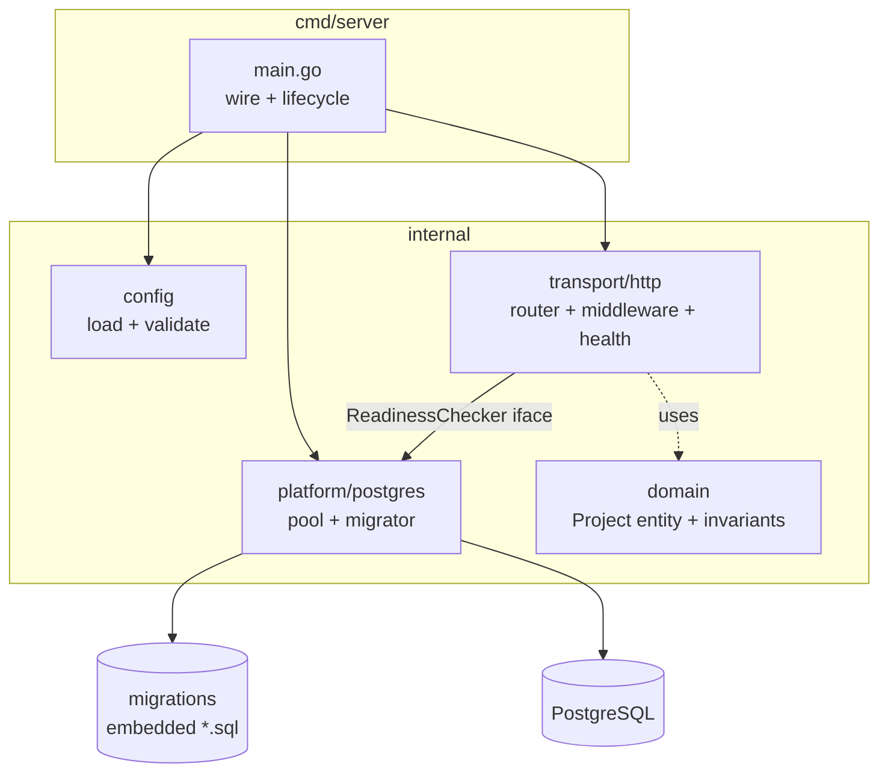

**Walkthrough.** `main.go` is the only place that wires concrete types together.
`config` is loaded and validated first. The `postgres` adapter owns the
connection pool and the embedded migrator. The `transport/http` layer depends on
the database only through the small `ReadinessChecker` interface it defines
itself (`Ping(ctx) error`), so the transport layer never imports the Postgres
package directly — this is the ports-and-adapters boundary that keeps business
logic independent of infrastructure. The `domain` package holds entities and
rules and imports nothing from the outer layers.

---

## 3. Startup and graceful shutdown sequence **[Built: M0]**

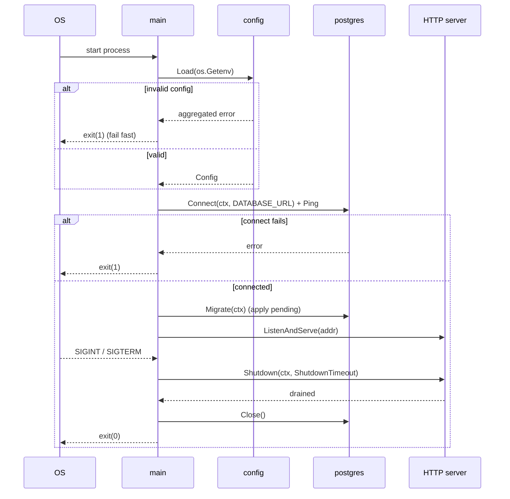

**Walkthrough.** Startup is strictly ordered and fails fast: bad configuration
or an unreachable database stops the process with a non-zero exit before any
traffic is served. On `serve`, pending migrations are applied, then the HTTP
server starts. A SIGINT/SIGTERM triggers a bounded graceful shutdown
(`ShutdownTimeout`) that drains in-flight requests before closing the pool.

---

## 4. Configuration load-and-validate flow **[Built: M0]**

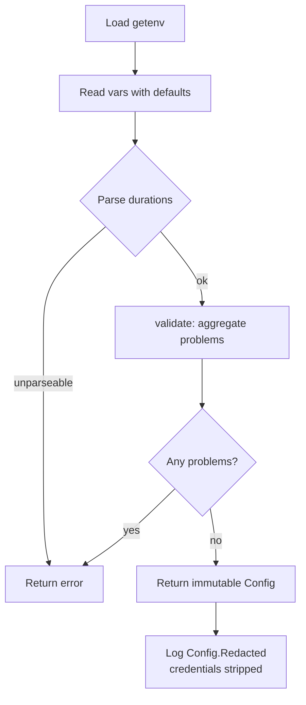

**Walkthrough.** Configuration is read once through an injectable `getenv`
function (so tests never touch the real environment). Every problem — a missing
`DATABASE_URL`, an unparseable duration — is aggregated so one run reports all of
them. Only a fully valid, immutable `Config` is returned. Startup logging uses
`Config.Redacted()`, which strips credentials from connection strings so secrets
never reach the logs.

---

## 5. Health vs readiness request lifecycle **[Built: M0]**

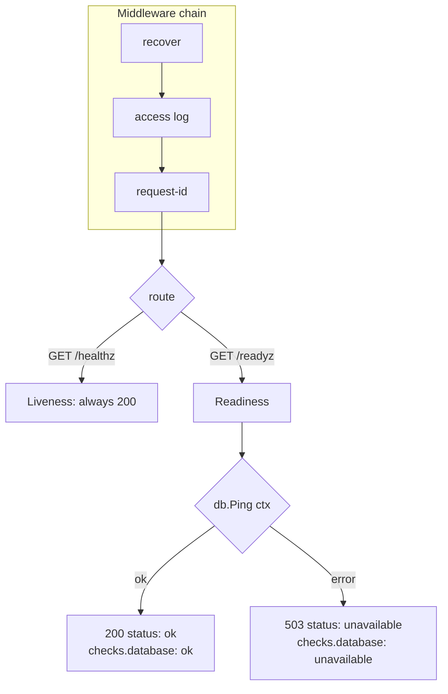

**Walkthrough.** Every request passes through panic recovery, structured access
logging (method, path, status, duration, request id — never bodies or headers,
which may carry secrets) and request-id assignment. `/healthz` is liveness: it
always returns 200 so a failing liveness probe means "restart me", not "a
dependency is down". `/readyz` is readiness: it pings the database and returns
503 when the dependency is unavailable, so load balancers stop routing to the
instance. Readiness never echoes the raw dependency error (which can carry host
or credential detail) — only a coarse `ok` / `unavailable` marker.

---

## 6. Database migration flow **[Built: M0]**

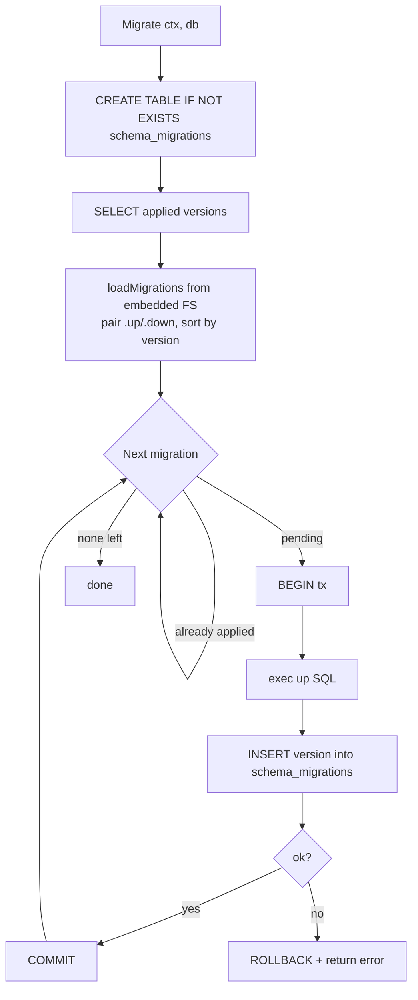

**Walkthrough.** Migrations are embedded in the binary. The migrator ensures a
`schema_migrations` ledger, reads the already-applied versions, and applies each
pending `*.up.sql` in version order. Each migration and its ledger insert run in
a **single transaction**, so a failure leaves the schema untouched and the run
can be retried. `rollback` applies the matching `*.down.sql` for the latest
applied version. This small in-house migrator is a deliberate Milestone 0
trade-off to keep the dependency surface minimal — see
[ADR 0004](adr/0004-minimal-migrator.md).

---

## 7. Project registration and webhook secret **[Built: M1]**

A project must be registered before PipelineSherlock will accept its webhooks.
Registration mints a per-project secret and stores only its hash.

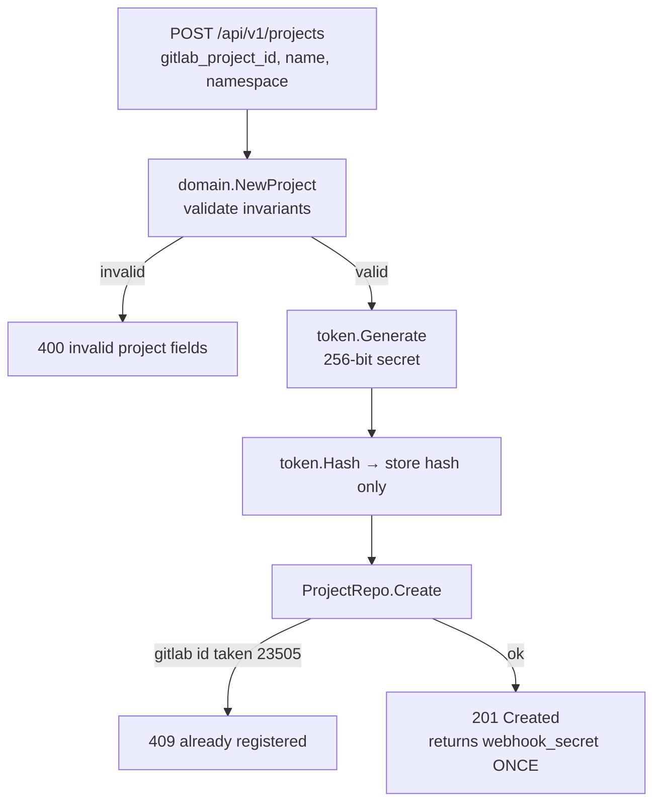

**Walkthrough.** The handler validates the body, then the domain validates the
project invariants. A high-entropy secret is generated; **only its SHA-256 hash
is persisted** (`projects.webhook_secret_hash`). The plaintext secret is
returned exactly once in the 201 response for the operator to paste into
GitLab's webhook config — it is never stored, logged, or retrievable again, and
`GET /api/v1/projects` never includes it. A duplicate GitLab id maps the unique
violation (SQLSTATE 23505) to a clean 409.

---

## 8. Webhook ingestion: validation + durable inbox + de-duplication **[Built: M1]**

The webhook endpoint authenticates the delivery, writes it to the durable inbox,
and acknowledges fast. Processing is asynchronous (next milestone).

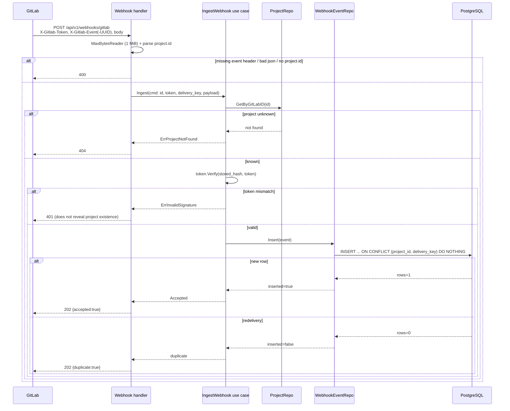

**Walkthrough.** The body is size-bounded before anything is read. The handler
derives a **delivery key** from GitLab's `X-Gitlab-Event-UUID` header, falling
back to a SHA-256 of the body so identical redeliveries still collapse. The use
case looks up the project, verifies the token against the stored hash with a
constant-time compare, and on success writes to the inbox. **De-duplication is
the database's job**: the unique `(project_id, delivery_key)` constraint plus
`ON CONFLICT DO NOTHING` means a redelivered webhook is a no-op — replaying the
same event many times still yields exactly one stored row (202 either way, with
`accepted` vs `duplicate`). The acknowledgement is fast because the event is
only persisted here; fetching traces and classifying happen asynchronously in a
later milestone.

---

## 9. Background worker: draining the inbox and reconciling state **[Built: M1]**

Webhook ingestion (§8) only persists the delivery and acknowledges. The actual
pipeline/job state is reconciled asynchronously by a background worker, so a
slow or unavailable GitLab API never blocks webhook acknowledgement.

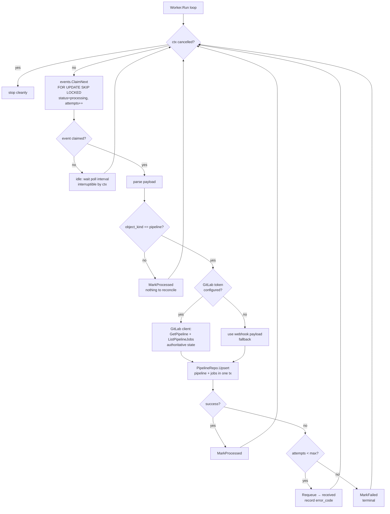

**Walkthrough.** The worker runs as a goroutine for the lifetime of the server
and stops on the same shutdown signal. Each iteration **claims** one event with
`ClaimNext`, which issues a single `UPDATE … WHERE id = (SELECT … FOR UPDATE SKIP
LOCKED LIMIT 1)` — the row lock with `SKIP LOCKED` means many workers could run
without ever claiming the same row, and the claim flips the status to
`processing` and increments `attempts` atomically. The payload is parsed; only
`object_kind == "pipeline"` carries pipeline state, so other event kinds are
acknowledged as processed with nothing to do. When a GitLab token is configured
the worker fetches **authoritative** pipeline and job state from the API (the
stored payload can be stale by the time it is processed); otherwise it falls
back to the payload itself. The result is upserted into `pipelines`/`jobs` in a
single transaction, keyed on the GitLab ids so reprocessing converges instead of
duplicating. Each **failed** job is then fingerprinted and its diagnosis stored
(the analysis engine in §11; the persistence flow in §12). On success the event
is marked `processed`. On failure it is
**requeued** (back to `received`, recording an error code) until the attempt
bound is reached, after which it is **failed** terminally. When the inbox is
empty the worker idles for a short, context-interruptible interval before
polling again, draining eagerly while work remains.

---

## 10. GitLab API client: pagination, timeouts and bounded retries **[Built: M1]**

The worker reads authoritative state through a small GitLab REST client that
owns its own resilience concerns, so the use case stays free of HTTP detail.

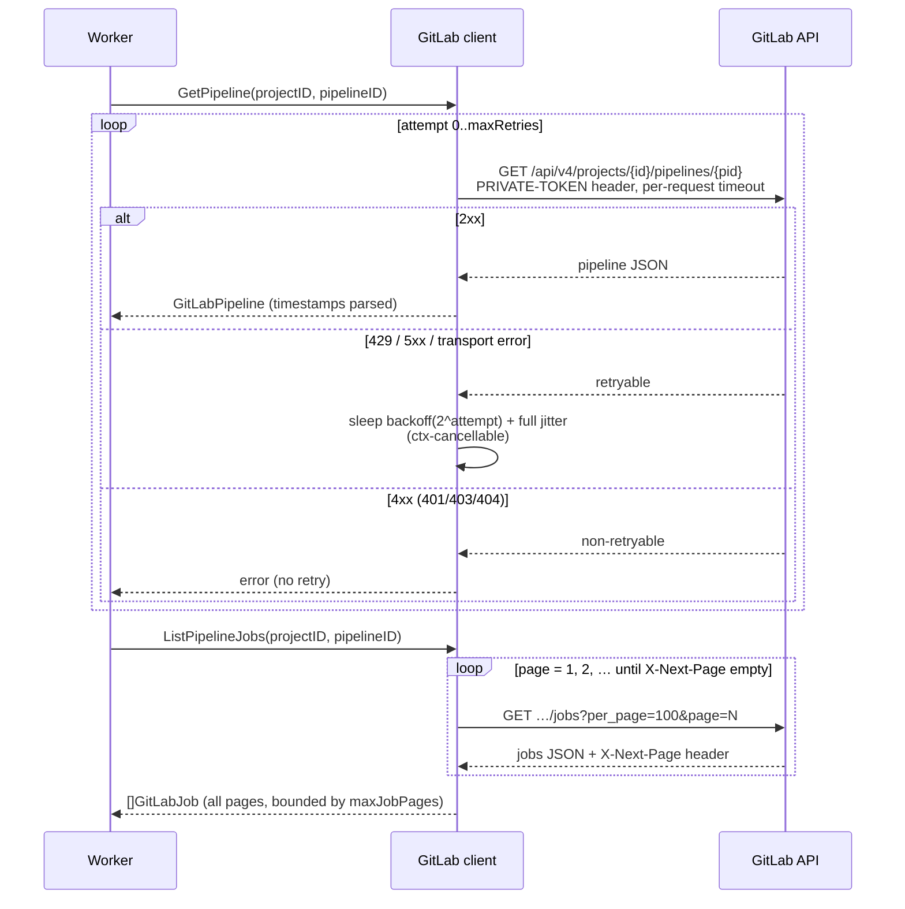

**Walkthrough.** Every request carries a `PRIVATE-TOKEN` header and is bounded by
the HTTP client's timeout. On a `429`, a `5xx`, or a transport error the client
retries up to a fixed bound, sleeping an exponentially growing delay with **full
jitter** (so many workers don't retry in lockstep) and honouring context
cancellation during the wait. Client errors such as `401`/`403`/`404` are **not**
retried — they will not fix themselves — and surface immediately. Job listing
follows GitLab's pagination: it requests pages of 100 and follows the
`X-Next-Page` response header until it is empty, with a hard page cap so a
misbehaving server cannot loop forever. Timestamps are parsed from RFC3339 and
durations normalized to whole seconds before the data crosses back into the
application layer as `GitLabPipeline` / `GitLabJob`.

---

## 11. Deterministic failure analysis: normalize → classify → fingerprint **[Built: M2]**

This is the project's differentiator. A failed job's log is reduced to a stable
**fingerprint** so that the *same* failure recurring across branches, runs and
time collapses to one identity — without any model guessing. The engine is pure
(no I/O, no clock, no randomness), which is what makes it reproducible and
testable. The worker now calls this engine for each failed job and persists the
result (see §12 for the storage flow).

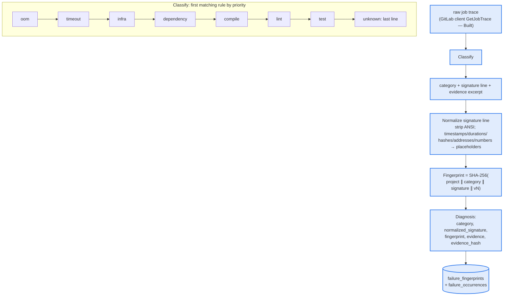

**Walkthrough.** The raw trace is first **classified** by scanning its lines
against an ordered rule set. Priority matters: environmental root causes (OOM,
timeout, infra) are checked before build and test symptoms, because a failing
test is often downstream of the real cause — so an out-of-memory run that also
prints `--- FAIL` is categorized as `oom`, not `test_failure`. The classifier
returns the single most salient line (the **signature line**) plus a short
human-readable **evidence** excerpt. The signature line is then **normalized**:
ANSI colour codes are stripped and every volatile token — timestamps, durations,
hashes, hex addresses, bare numbers — is replaced with a placeholder, so two
runs of the same failure that differ only in those tokens produce an identical
signature. Finally the **fingerprint** is a SHA-256 over the project id,
category, normalized signature and an `algorithm_version`, with a separator
between fields so adjacent fields cannot collide. The version lets the scheme
change later without clashing with old fingerprints. The result is a
`Diagnosis` carrying everything the next slice needs to upsert into
`failure_fingerprints` (incrementing an occurrence count) and append to
`failure_occurrences` with the evidence attached.

---

## 12. Fingerprint persistence and worker wiring **[Built: M2]**

The worker drives the analysis engine: after a failed pipeline's jobs are
upserted, each **failed** job's trace is fetched, analysed, and its diagnosis
recorded. Recording is idempotent so reprocessing an event never double-counts.

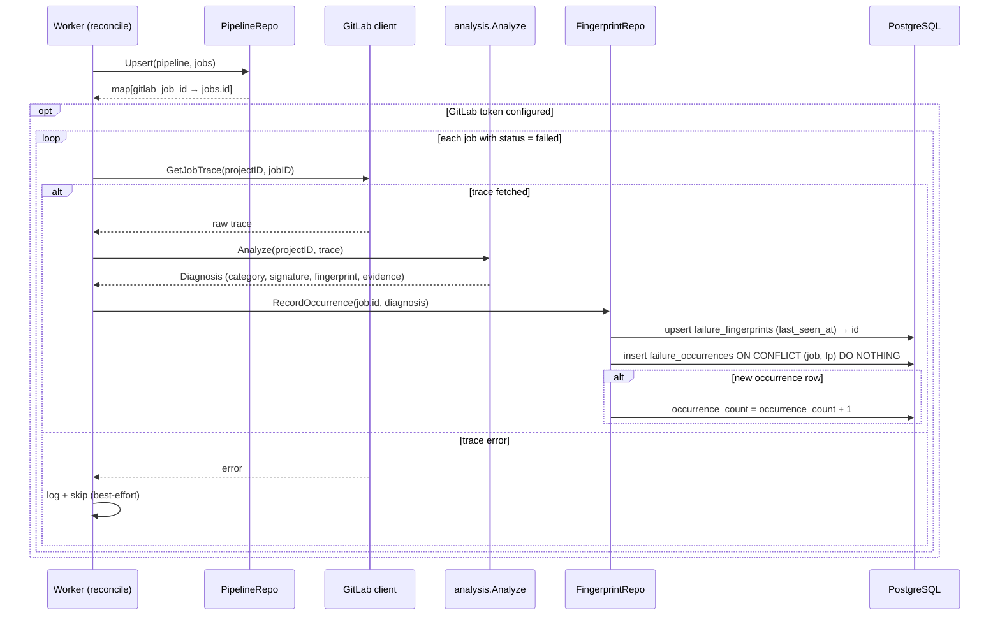

**Walkthrough.** `PipelineRepo.Upsert` now returns the persisted row id for each
job, so occurrences can point at the exact `jobs` row. Fingerprinting requires
the job log, which is only available through the GitLab API, so it runs **only
when a token is configured** — without one, the worker still reconciles and
stores pipeline/job state, it just doesn't fingerprint. For each failed job the
worker fetches the trace, runs the pure `Analyze`, and calls
`RecordOccurrence`, which in **one transaction** upserts the fingerprint
(refreshing `last_seen_at`), inserts the occurrence under a unique
`(job_id, fingerprint_id)` constraint, and increments `occurrence_count` **only
when a new occurrence row was actually written**. That uniqueness is what makes
reprocessing safe: the same job's failure recorded twice yields one occurrence
and a count of one. Fingerprinting is **best-effort** — a trace-fetch or
persistence error for one job is logged and skipped, never failing the event,
because the authoritative pipeline/job state is already stored. Storing the
occurrence history is what later milestones will group into incidents.

---

## 13. Incident read path: grouping fingerprints for the API **[Built: M3 slice 1]**

Milestone 3 begins turning stored fingerprints into **incidents** — the
user-facing "this failure has happened N times" unit. Slice 1 is the read path:
list a project's incidents over the API. Incident *detail* (occurrences,
affected refs, flaky / regression flags) is slice 2.

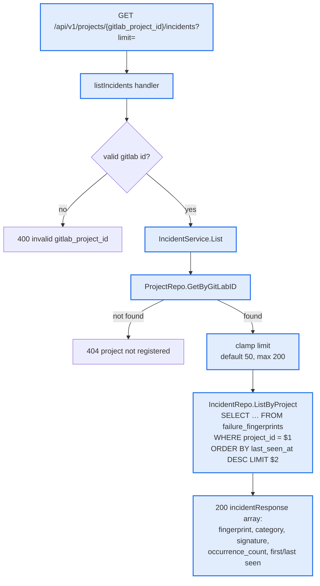

**Walkthrough.** The endpoint is keyed by the **GitLab** project id (what a
GitLab user knows), not the internal UUID. The handler validates the id and
reads an optional `limit`, then the `IncidentService` resolves the GitLab id to
the registered project — returning a clean 404 if it was never registered —
before querying. Each `failure_fingerprints` row already carries its aggregate
(`occurrence_count`, `first_seen_at`, `last_seen_at`), which the earlier
recording step maintains, so grouping is a simple ordered read rather than an
expensive scan of `failure_occurrences`: **one incident per fingerprint**, most
recently seen first. The list size is clamped (default 50, max 200) so a caller
can't ask for an unbounded result. The transport layer depends only on a small
`IncidentLister` interface, keeping it decoupled from the use case and adapter —
the same ports-and-adapters boundary used throughout.

---

## 14. Incident detail: occurrence history & heuristic signals **[Built: M3 slice 2]**

Slice 2 completes the incident view. Where the list (slice 1) answers "which
failures are happening", the detail endpoint answers "what is the shape of this
one failure" — its occurrence history enriched with the pipeline/job context,
a per-ref breakdown, and two heuristic signals (flaky / regression candidates).

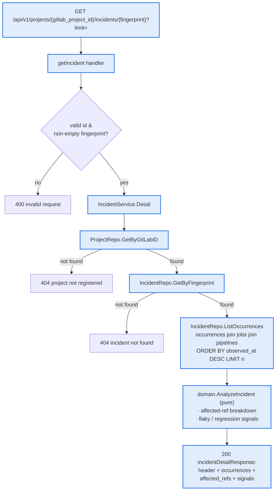

**Walkthrough.** The handler validates the GitLab id and the fingerprint, then
`IncidentService.Detail` resolves the project (404 if unregistered), loads the
fingerprint header (404 if the project has no such fingerprint), and reads the
occurrence history. `ListOccurrences` joins each `failure_occurrences` row to
its `jobs` row and then its `pipelines` row, so every occurrence carries the
`ref`, `sha`, job name, stage and GitLab ids it was seen in — the evidence a
human needs to judge the failure. The list is clamped (default 100, max 500).

**Deterministic signals, honestly scoped.** `domain.AnalyzeIncident` is a pure
function over the occurrence list — no clock, no I/O — so the same history
always yields the same breakdown and the same flags. Two signals are derived:

- **`flaky_suspected`** — some single commit (`sha`) produced this failure in
  **more than one** pipeline run. The same input failing not-every-time is a
  classic nondeterminism signal.
- **`regression_suspected`** — the failure recurs across **two or more distinct
  commits**, i.e. it persists as the branch moves forward rather than being a
  one-off.

These are deliberately framed as *candidates for review*, not verdicts. The
system records only failures, not successes, so it cannot yet prove a test
passed-then-failed on the same commit; the signals describe the shape of the
failure history and the response exposes the raw counts
(`distinct_refs`, `distinct_shas`) so a reader can judge for themselves. This
keeps the feature within the project's "evidence-backed, not guessing" promise.
Richer detection (using success data and timing) is future work.

---

## 15. Dashboard: incidents list view **[Built: M4 slice 1]**

Milestone 4 puts a UI in front of the read API. Slice 1 is the incidents list:
the operator enters a registered GitLab project id and sees that project's
failure incidents, most recently seen first. Incident *detail* drill-down
(occurrences + signals) is slice 2.

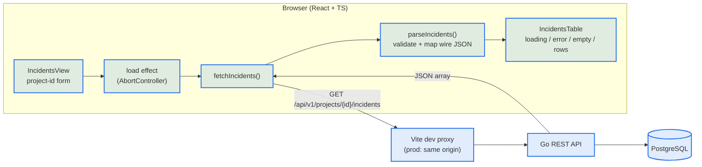

**Walkthrough.** The view follows a **container / presentational** split:
`IncidentsView` owns the selected project id and the load lifecycle, while
`IncidentsTable` is a pure renderer of rows. The fetch runs in an effect keyed
on the submitted id and is cancelled via `AbortController` on change or unmount,
so a stale response can never overwrite a newer one. Every load resolves to one
of four explicit states — **loading**, **error**, **empty**, or **rows** — each
with its own message, rather than a blank screen or a spinner that never ends.

**Boundary validation.** `parseIncidents` validates the server's JSON at the
client boundary (never trust external data) and maps the snake_case wire format
to camelCase domain types; a malformed field throws a typed `IncidentsError`
rather than rendering `undefined`. The client distinguishes a 404 (project not
registered → a friendly message) from other failures. In development the Vite
proxy forwards `/api` to the Go backend so the SPA and API share an origin; in
production they are served from the same origin, so no CORS handling is needed.

The frontend now has its own test runner (Vitest + Testing Library + jsdom):
the parser, the fetch client and the view are unit-tested, and the suite runs
in CI alongside the type-check and build.

---

## 16. Dashboard: incident detail drill-down **[Built: M4 slice 2]**

Slice 2 makes each incident row open its detail: the occurrence history, a
per-ref breakdown, and the heuristic signals from the M3 detail API — the full
evidence behind "this failure happened N times".

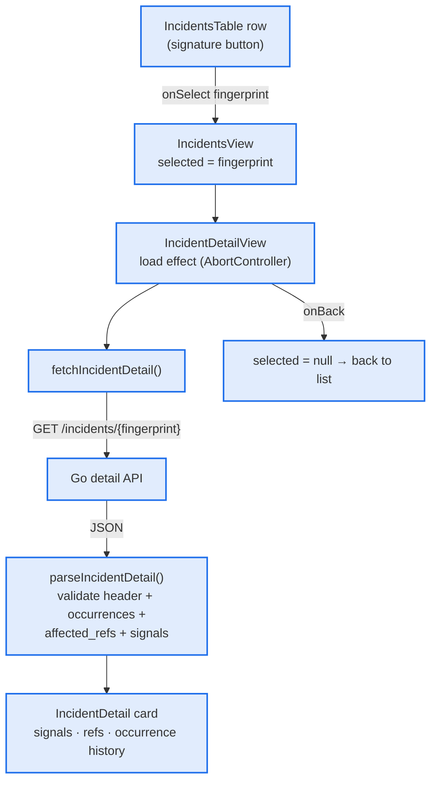

**Walkthrough.** Selection is state in `IncidentsView`: a row's signature is a
button that sets the selected fingerprint; the view then swaps the list for
`IncidentDetailView`, a second container that owns the detail load (keyed on
project + fingerprint, cancelled on change/unmount like the list). The list's
own loaded state is preserved, so **Back** is instant with no refetch. Starting
a new project load clears the selection.

`parseIncidentDetail` extends the boundary validation to the nested shape —
occurrences, the per-ref breakdown and the six signal booleans — so a malformed
field throws rather than rendering `undefined`. The detail fetch reads the
server's 404 error text to distinguish an unregistered project from an unknown
fingerprint. The card presents the two signals as **candidates for review**
(matching §14's honest framing) and shows the raw `distinct_refs` /
`distinct_shas` counts beside them.

Selection is in-memory for now; making it deep-linkable via the URL is a noted
follow-up.

---

## 17. GitLab merge-request write-back engine **[Built: M5 slice 1]**

Milestone 5 closes the loop: when a known failure fingerprint shows up in a
merge request's pipeline, PipelineSherlock posts the evidence back as an MR
comment. Slice 1 builds the write-back **engine** — the domain entity, the
idempotent persistence, the GitLab POST and the use case that ties them
together — fully unit-tested. Detecting the MR from a pipeline and calling this
engine from the background worker is slice 2, so no node below is wired into the
worker yet.

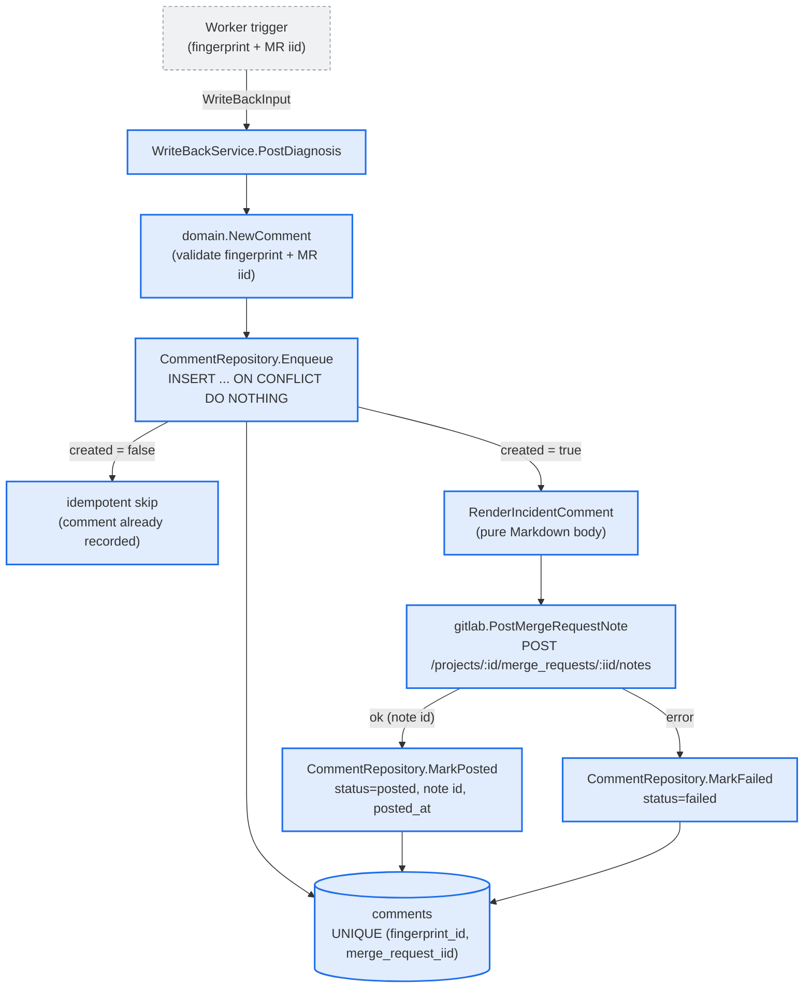

**Walkthrough.** `PostDiagnosis` first builds a `domain.Comment`, which enforces
a non-empty fingerprint and a positive merge-request iid. It then calls
`CommentRepository.Enqueue`, whose `INSERT ... ON CONFLICT DO NOTHING` on the new
`comments_fingerprint_mr_unique` constraint (migration 0005) is the idempotency
pivot: the first call for a (fingerprint, MR) pair returns `created = true` with
the new row id, and any later call returns `created = false` with the *same* id.
On `created = false` the use case stops — no second note is ever posted for the
same incident on the same MR.

On a new comment it renders the body with `RenderIncidentComment`, a pure
function (no clock, IO or randomness — the same incident always produces the same
Markdown), and posts it through `gitlab.PostMergeRequestNote`. That method reuses
the client's retry/backoff policy via a new `doPost` path; it is defined against a
small consumer-side `MergeRequestCommenter` interface so the write-back use case
never depends on the wider `GitLabClient` surface. A successful post records the
GitLab note id and timestamp (`MarkPosted`); a failure marks the row `failed` and
returns the error so the caller can decide whether to retry.

Write-back is opt-in by design (it needs a configured GitLab token), and the
comment is framed as a deterministic fingerprint match, not a verdict —
consistent with the signal framing in §14. Slice 2 will detect the MR iid from
the pipeline/webhook, wire `WriteBackService` into the worker, and gate it behind
a write-back toggle in `cmd/server`.

---

## 18. Wiring write-back into the worker **[Built: M5 slice 2]**

Slice 1 built the write-back engine in isolation; slice 2 connects it to the
live failure path. When the worker fingerprints a failed job on a merge-request
pipeline, and write-back is switched on, it now posts the diagnosis back to that
merge request.

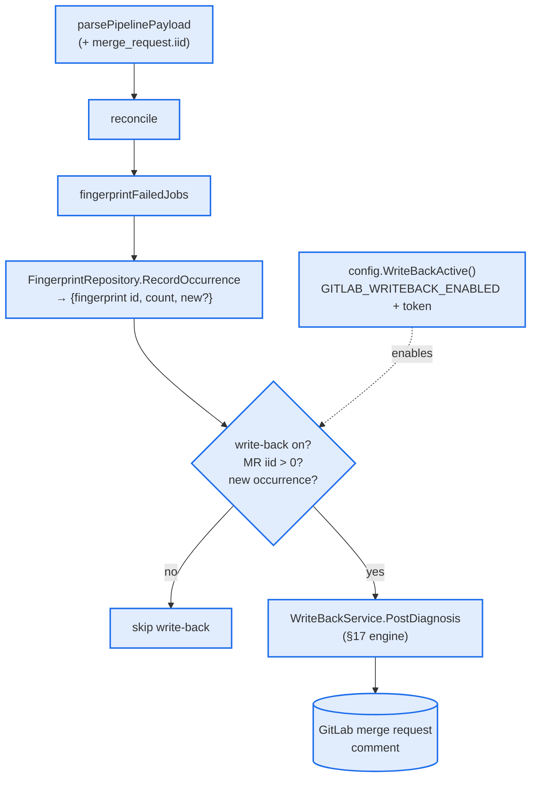

**Walkthrough.** Three things had to meet for the worker to drive write-back.
First, the **MR iid**: `parsePipelinePayload` now reads `merge_request.iid` from
the pipeline webhook body (0 when the pipeline is not attached to an MR). Second,
the **fingerprint identity**: `RecordOccurrence` returns a
`RecordOccurrenceResult` — the fingerprint row id, the running occurrence count,
and whether this call wrote a *new* occurrence — so the processor has exactly
what `WriteBackInput` needs without a second read. Third, the **switch**:
`config.WriteBackActive()` requires both `GITLAB_WRITEBACK_ENABLED` and a GitLab
token, and `cmd/server` passes `application.WithWriteBack(...)` to the processor
only then.

`maybeWriteBack` fires only when all three hold — write-back enabled, `MR iid >
0`, and a new occurrence — then calls the §17 engine. Gating on *new occurrence*
avoids redundant work on reprocess, while the engine's own
`(fingerprint, MR)` idempotency remains the true guard against duplicate
comments (a recurrence of the same fingerprint on the same MR is enqueued, sees
the existing row, and skips). Write-back is best-effort: a post failure is logged
and recorded as a failed comment, never failing the event, because the
pipeline/job/fingerprint state is already persisted. The default build (no token,
or the flag off) behaves exactly as before — the processor is constructed with no
write-back option.

---

## 19. API-key authentication **[Built: M6 slice 1]**

The first production-readiness milestone closes the open door left by M0–M5:
every `/api/v1` data route now requires a valid API key. This is slice 1 of M6
in the [production-readiness roadmap](production-readiness-roadmap.md).

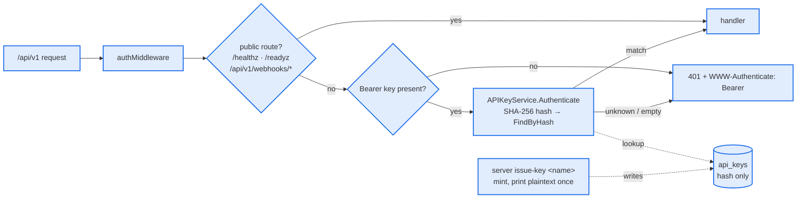

**Walkthrough.** `authMiddleware` sits in the chain inside request-id and logging
(so rejected calls are still traced) and outside the mux. It first asks
`requiresAuth`: a path is protected when it is under `/api/v1/` **and not** under
`/api/v1/webhooks/`. The health probes live outside `/api/v1` and the GitLab
webhook keeps its own per-project token (§7–§8), so both stay public — the
webhook must not demand an operator key from GitLab.

For a protected route the middleware extracts a bearer token from the
`Authorization` header. A missing or malformed header, an empty token, or no
configured authenticator all **fail closed** with `401` and a
`WWW-Authenticate: Bearer` challenge. Otherwise it calls
`APIKeyService.Authenticate`, which hashes the presented key with the existing
`platform/token` SHA-256 helper and looks it up by hash (`FindByHash`). The
comparison is over hashes, never the secret, so a direct indexed lookup leaks
nothing useful about any key's plaintext; an unknown key returns the opaque
`ErrUnauthenticated`, which the middleware maps to the same `401` as a missing
key (callers cannot distinguish "no key" from "wrong key").

Keys are stored hash-only in `api_keys` (migration 0006), mirroring the
webhook-secret discipline: the plaintext is shown exactly once, when an operator
runs `server issue-key <name>`, and is never logged. `cmd/server` wires the
`APIKeyService` into the router unconditionally, so the authenticated surface is
never accidentally disabled. (The M4 dashboard calls `/api/v1` and will now get
`401` until it sends a key — dashboard auth is M14 slice 1. Per-caller
authorization scoping is M6 slice 2.)

---

## Related documents

- [ADR 0001 — Record architecture decisions](adr/0001-record-architecture-decisions.md)
- [ADR 0002 — Modular monolith](adr/0002-modular-monolith.md)
- [ADR 0003 — Go / React / PostgreSQL stack](adr/0003-tech-stack.md)
- [ADR 0004 — Minimal in-house migrator for M0](adr/0004-minimal-migrator.md)
- [PROJECT_STATUS.md](../PROJECT_STATUS.md) — what is done, what is next
