# Production Readiness Roadmap

PipelineSherlock is **feature-complete** through Milestones 0–5 (ingestion →
deterministic analysis/fingerprinting → incidents + signals → dashboard → GitLab
merge-request write-back) and green in CI. It is an early-stage portfolio
project, **not yet a production system**. This roadmap turns it into one.

It is organised exactly like the build so far: numbered **milestones**, each split
into **PR-sized vertical slices**. Every slice is one reviewable pull request,
built test-first, and carries a **workflow diagram** for the mechanism it adds.

## How to read this

- **One slice = one PR.** Each is a self-contained vertical slice that leaves the
  system working and green.
- **Diagrams are `[Planned]` here.** Following the project convention, every
  mechanism gets a Mermaid workflow diagram. The diagrams below are `[Planned]`;
  when a slice ships, its diagram graduates into
  [architecture.md](architecture.md) as a `[Built: Mx slice y]` section with a
  prose walkthrough, and this file's entry is ticked off.
- **Diagram legend.** Solid blue nodes already exist in the codebase today;
  dashed grey nodes are what the slice adds.
- **Per-slice "Done when"** is the acceptance gate. Every slice additionally
  keeps the standing bar: `gofmt` clean, `go vet`/`go build`/`go test ./...`
  green, integration tests compile (and pass against Postgres in CI), frontend
  tests + build green where touched, and CI green on the branch.

## Critical path (ordering)

The blockers that gate any real deployment come first; the rest is hardening you
can sequence by risk appetite.

| Order | Milestone | Why it is where it is |
|------|-----------|-----------------------|
| 1 | **M6 — API authn & authz** | The API is open today; nothing else matters if anyone can read any project. |
| 2 | **M7 — Secrets & per-project GitLab identity** | One shared PAT is a multi-tenant blocker; secrets must leave plain env. |
| 3 | **M8 — Transport hardening** | TLS, headers, CORS, rate limiting before public exposure. |
| 4 | **M9 — Safe deploys & config** | Migrations-on-boot must stop before running more than one replica. |
| 5 | **M10 — Observability** | You cannot operate what you cannot see. |
| 6 | **M11 — Reliability & scale** | Independent worker, dead-letter, GitLab budget. |
| 7 | **M12 — Data, DR & compliance** | Backups, DB TLS, retention, PII. |
| 8 | **M13 — Supply chain & release** | Scanning, signed images, staged rollout. |
| 9 | **M14 — Frontend production** | Auth + hardened serving for the dashboard. |

M6, M7, M8.1 and M9.1 are the true go/no-go blockers (~1–2 weeks of focused
work). Everything after is hardening.

---

## M6 — API authentication & authorization

Goal: no endpoint under `/api/v1` serves data without an authenticated,
authorized caller.

### M6 · Slice 1 — API authentication **[Built — see architecture.md §19]**

**Goal.** Require a valid API key on every `/api/v1` request; reject the rest
with 401.
**Changes.** New `api_keys` table + migration (store SHA-256 hashes, reuse the
webhook-secret hashing from `platform/token`); `ApiKeyRepository` port + Postgres
adapter; an auth middleware in `transport/http`; an admin path (or CLI) to mint a
key (plaintext shown once). `/healthz`/`/readyz` stay public.
**Tests.** Middleware unit tests (valid / missing / malformed / unknown key,
constant-time compare); integration test for the key store.
**Done when.** Every `/api/v1` route returns 401 without a valid key and 200/201
with one; health probes remain public.

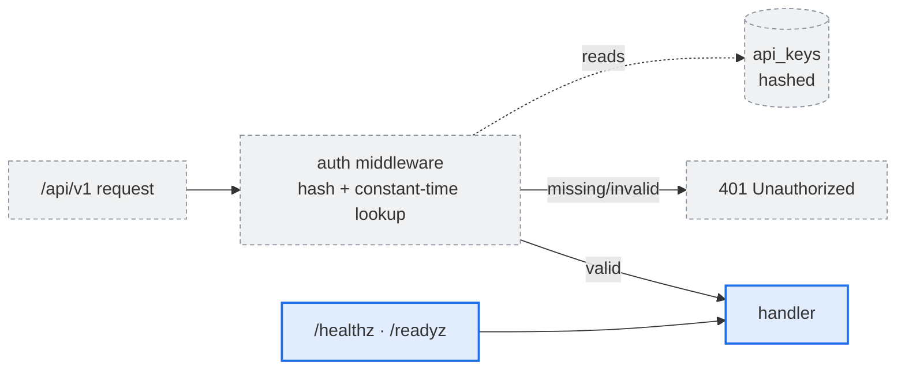

### M6 · Slice 2 — Authorization scoping **[Built — see architecture.md §20]**

**Goal.** A caller only sees and mutates projects it owns.
**Changes.** Associate each API key with an owner/org; add an `owner_id` to
`projects`; scope `IncidentService` and project registration by the
authenticated owner; 403 on cross-owner access, 404 to avoid leaking existence.
**Tests.** Unit tests for the scoping decision; integration tests proving owner A
cannot read owner B's incidents.
**Done when.** Cross-tenant reads/writes are refused; same-tenant behaviour is
unchanged.

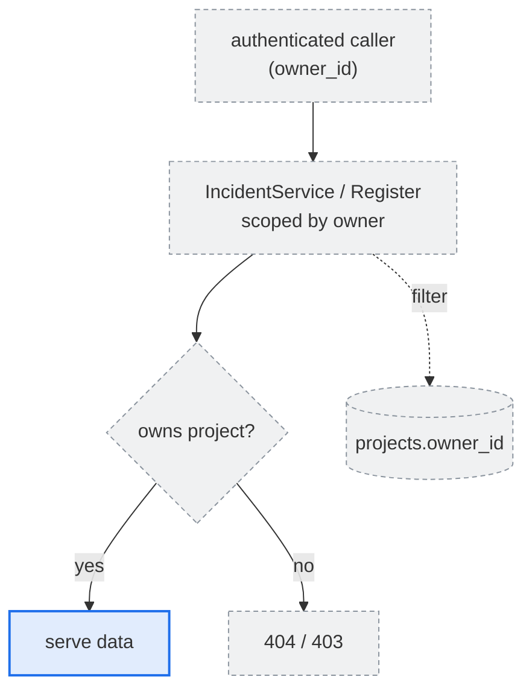

---

## M7 — Secrets & per-project GitLab identity

Goal: no long-lived secret in plain env, and each project carries its own GitLab
credential instead of one shared PAT.

### M7 · Slice 1 — Secret provider port **[Built — see architecture.md §21]**

**Goal.** Load secrets through a provider abstraction, not raw `os.Getenv`.
**Changes.** A `Provider` port (`Get(ctx, name)`) in `internal/platform/secret`,
an env-backed default, and a dependency-free `FileProvider` (mounted-secret
files) as the opt-in real adapter — selected by `SECRET_PROVIDER` (a cloud
adapter such as AWS Secrets Manager / Vault is a future slice behind the same
port); `config.Load` resolves `DATABASE_URL`/`GITLAB_TOKEN` via the provider with
its signature unchanged.
**Tests.** Provider contract tests (env + file + selector); config load tests
(file-provider and unknown-provider paths).
**Done when.** The service boots with secrets sourced from the provider; env
remains the local-dev default. ✅

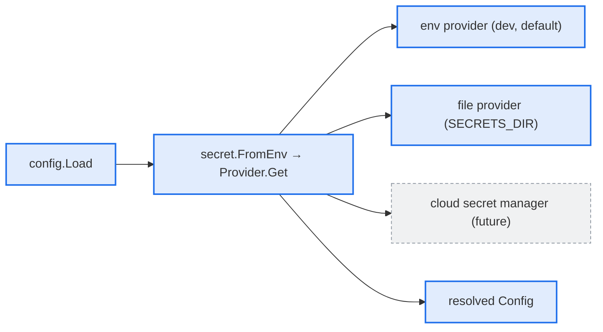

### M7 · Slice 2 — Per-project GitLab credentials **[Built — see architecture.md §22]**

**Goal.** The worker uses each project's own token, not one global PAT.
**Changes.** Store an encrypted GitLab token per project (envelope encryption with
the `ENCRYPTION_KEY` master key from the secret provider, `internal/platform/crypto`);
resolve the token at reconcile/write-back time by project; fall back to the global
token only if configured.
**Tests.** Token-resolution unit tests; integration test for encrypted
store/round-trip.
**Done when.** Two projects with different tokens reconcile independently; no
plaintext token at rest. ✅

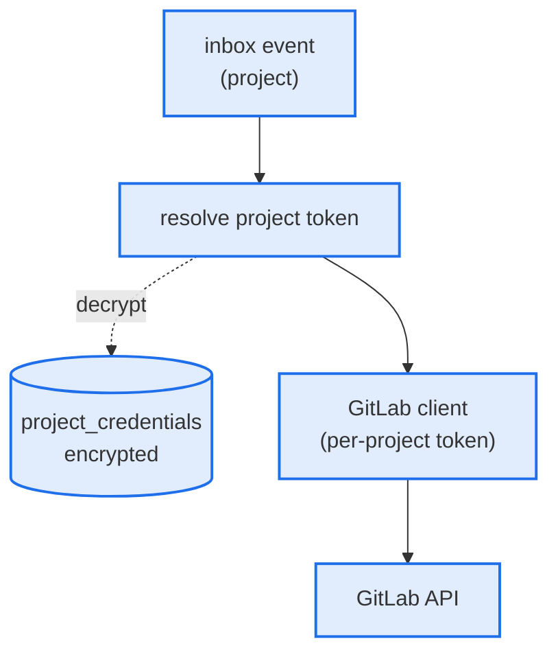

---

## M8 — Transport hardening

Goal: safe to expose publicly — TLS, security headers, CORS, and rate limiting.

### M8 · Slice 1 — TLS, security headers & CORS **[Planned]**

**Goal.** Enforce HTTPS posture and a strict cross-origin policy.
**Changes.** Security-header middleware (HSTS, `X-Content-Type-Options`,
`X-Frame-Options`, `Referrer-Policy`, CSP for API responses); configurable CORS
allow-list for the dashboard origin; document TLS termination at the ingress and
set DB `sslmode=verify-full` expectations (DB TLS lands in M12.1).
**Tests.** Middleware unit tests (headers present; CORS allow/deny; preflight).
**Done when.** Responses carry the headers; only allow-listed origins pass CORS.

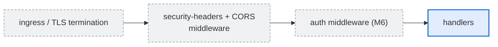

### M8 · Slice 2 — Rate limiting **[Planned]**

**Goal.** Bound request and webhook volume per caller/source.
**Changes.** A `RateLimiter` port with a Redis token-bucket adapter (Redis is
already wired as optional); apply to `/api/v1` by key and to the webhook endpoint
by project/source; 429 with `Retry-After` on exhaustion; in-memory fallback when
Redis is absent.
**Tests.** Limiter unit tests (bucket refill, burst, exhaustion); handler tests
returning 429.
**Done when.** Excess requests get 429; limits are configurable.

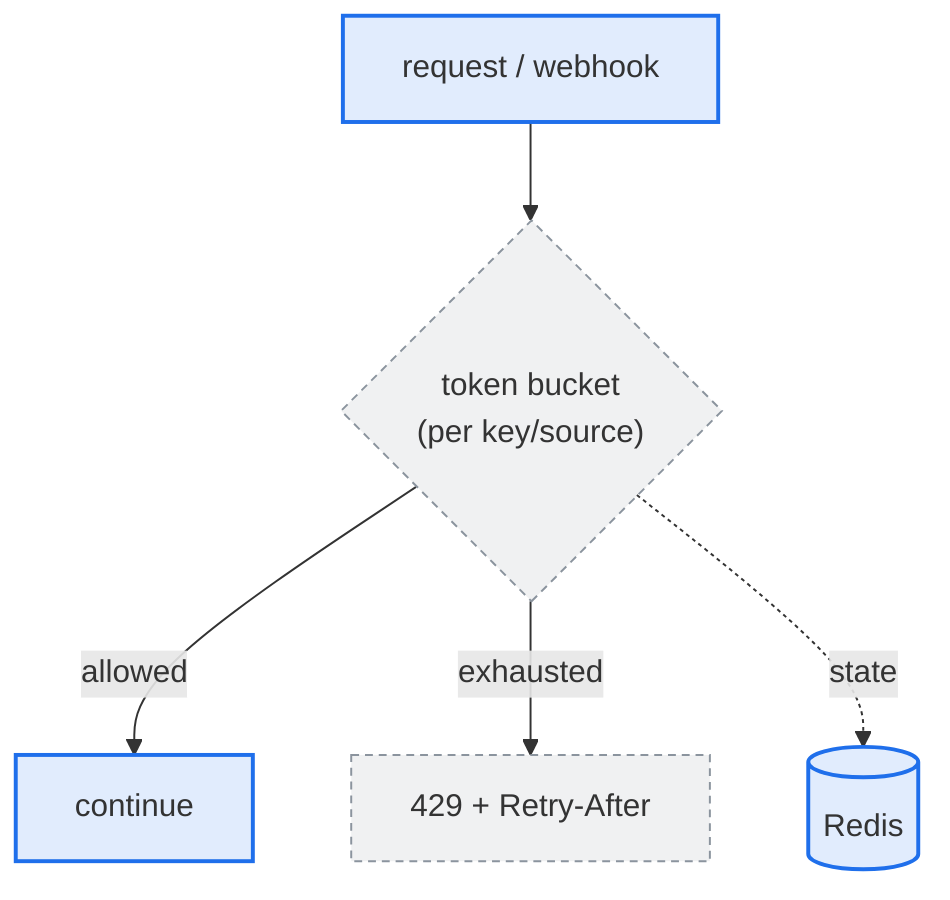

---

## M9 — Safe deploys & configuration

Goal: deploy multiple replicas safely and refuse to start misconfigured.

### M9 · Slice 1 — Migrations out of boot **[Planned]**

**Goal.** `serve` no longer migrates; a dedicated step does.
**Changes.** `serve` verifies the schema is at the expected version and exits
with a clear error if not; migrations run only via `server migrate` (a deploy
Job/initContainer); add a `schema_version` check helper.
**Tests.** Unit test: `serve` refuses to start on an out-of-date schema;
integration test for the migrate-then-verify path.
**Done when.** N replicas can start concurrently without racing migrations.

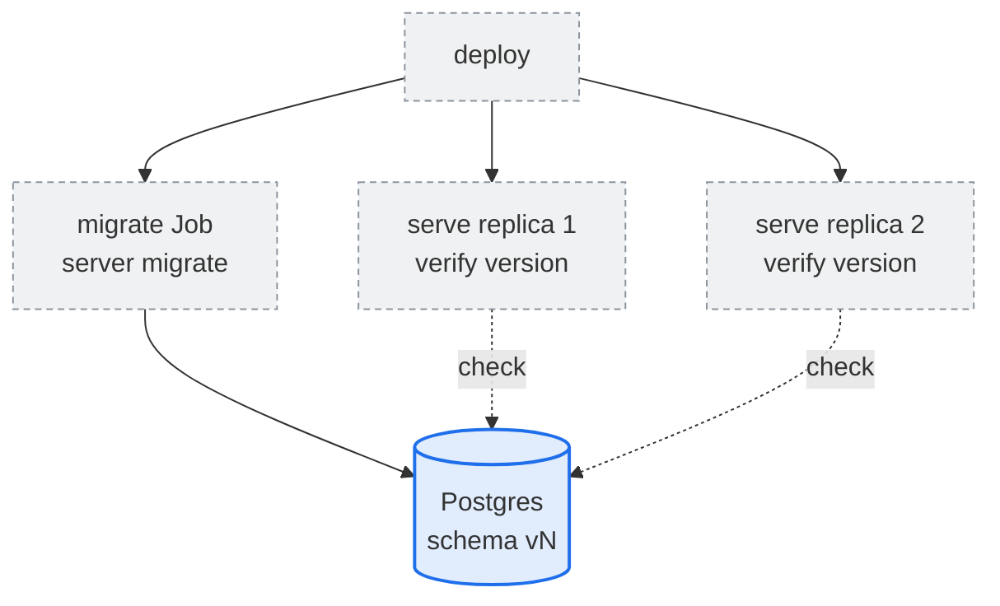

### M9 · Slice 2 — Production config strictness & pool tuning **[Planned]**

**Goal.** Fail fast on unsafe prod config; tune the DB pool.
**Changes.** When `APP_ENV=production`, require explicit DB/Redis/base URLs and
reject dev defaults and `sslmode=disable`; expose pgx pool sizing/timeouts via
config with sane prod defaults.
**Tests.** Config validation tests (prod rejects defaults; pool values parsed).
**Done when.** A misconfigured prod boot fails with an explicit message; pool is
bounded.

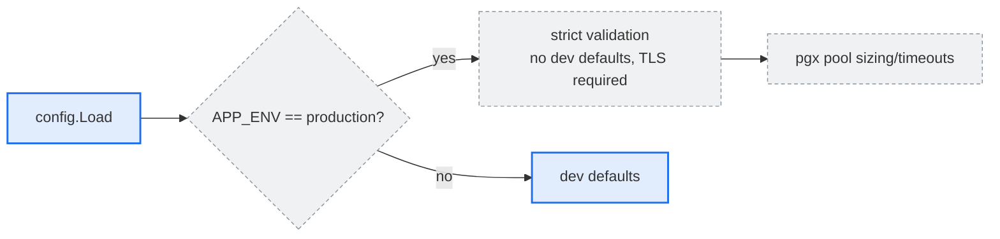

---

## M10 — Observability

Goal: metrics, traces and error tracking so the service can be operated.

### M10 · Slice 1 — Metrics **[Planned]**

**Goal.** Expose Prometheus metrics for the HTTP and worker paths.
**Changes.** A `/metrics` endpoint; counters/histograms for HTTP latency & status,
events processed/requeued/failed, inbox depth, fingerprints recorded, write-back
posted/failed.
**Tests.** Metric-registration unit tests; a handler test scraping `/metrics`.
**Done when.** Key rates and latencies are visible on `/metrics`.

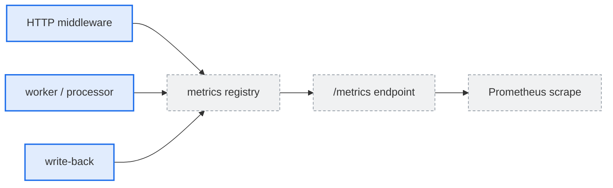

### M10 · Slice 2 — Tracing & correlation id **[Planned]**

**Goal.** Trace a failure from webhook to MR comment.
**Changes.** OpenTelemetry spans across ingest → worker → GitLab client → DB; a
request/correlation id generated at ingress, carried on the inbox event, and
logged on every step.
**Tests.** Propagation unit tests (id flows ingest → processor); span-emission
assertions with a test exporter.
**Done when.** One trace links a webhook to its fingerprint and write-back.

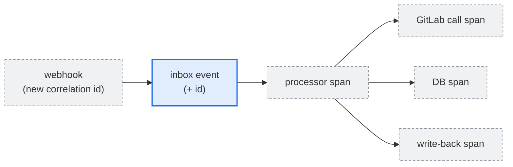

### M10 · Slice 3 — Error tracking & audit log **[Planned]**

**Goal.** Surface best-effort failures and record sensitive actions.
**Changes.** Integrate an error tracker (e.g. Sentry) for panics and the
currently log-only failures (trace fetch, write-back); an append-only `audit_log`
for project registration, key minting and posted comments.
**Tests.** Unit tests that failures are reported; integration test for audit
rows.
**Done when.** A write-back failure raises an alertable event and leaves an audit
trail.

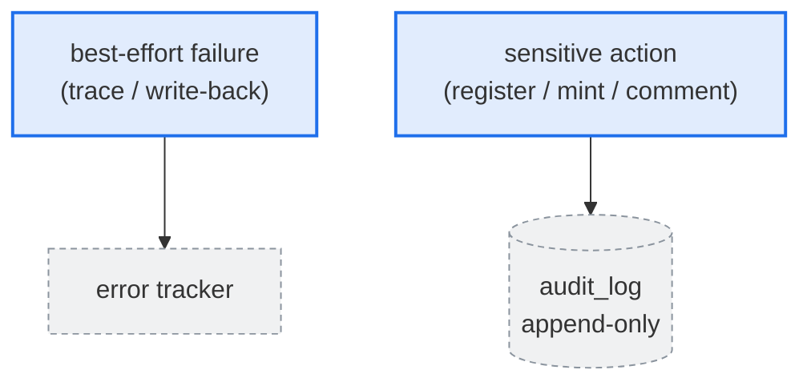

---

## M11 — Reliability & scale

Goal: scale the worker independently and handle poison events and GitLab limits.

### M11 · Slice 1 — Standalone worker deployable **[Planned]**

**Goal.** Run the worker as its own process so API and worker scale apart.
**Changes.** A `cmd/worker` entry point reusing the same application wiring; the
API `serve` can optionally stop running the in-process worker; `SKIP LOCKED`
already makes concurrent workers safe.
**Tests.** Wiring/smoke test for `cmd/worker`; existing worker tests unchanged.
**Done when.** API and worker run as separate deployables sharing one database.

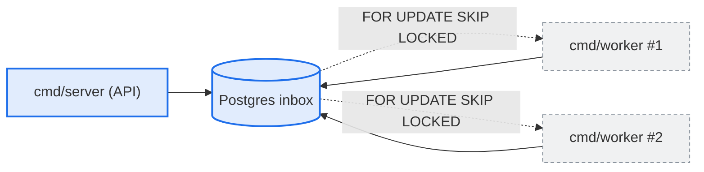

### M11 · Slice 2 — Dead-letter view & replay **[Planned]**

**Goal.** Make terminally-failed events visible and replayable.
**Changes.** A read API/CLI listing `failed` inbox events with their last error; a
guarded replay that resets an event to `received`.
**Tests.** Unit tests for list/replay; integration test for the failed→received
transition.
**Done when.** An operator can inspect and replay a failed event.

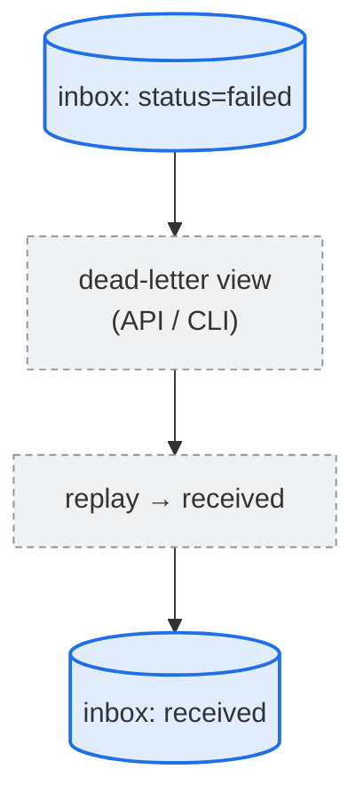

### M11 · Slice 3 — GitLab rate budget & circuit breaker **[Planned]**

**Goal.** One busy project cannot starve others or hammer GitLab on outages.
**Changes.** A shared client-side rate limiter honouring GitLab `RateLimit-*`
headers; a circuit breaker that trips on sustained 5xx/429 and sheds load with
backoff.
**Tests.** Limiter/breaker unit tests (trip, half-open, recover) with a fake
transport.
**Done when.** Under 429/5xx the client backs off globally instead of retrying
blindly.

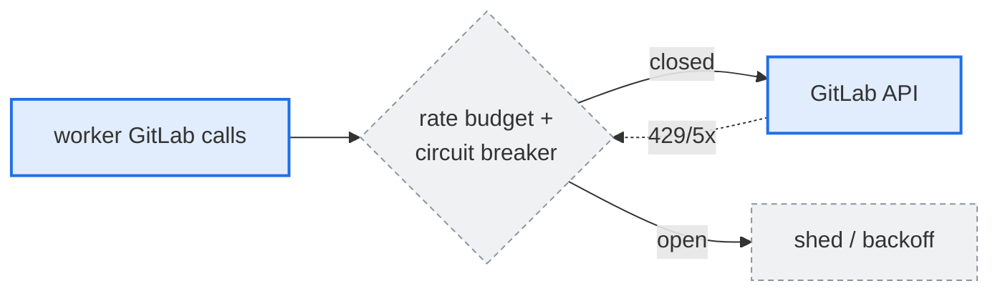

---

## M12 — Data, DR & compliance

Goal: encrypted, backed-up data with a retention and PII story.

### M12 · Slice 1 — DB TLS & backups/PITR **[Planned]**

**Goal.** Encrypt DB traffic and make data recoverable.
**Changes.** Require `sslmode=verify-full` in prod; document/automate base backups
+ WAL archiving (PITR) and a tested restore runbook.
**Tests.** Config test rejecting non-TLS DSN in prod; a documented restore drill.
**Done when.** Prod refuses a non-TLS DB connection and a restore has been
rehearsed.

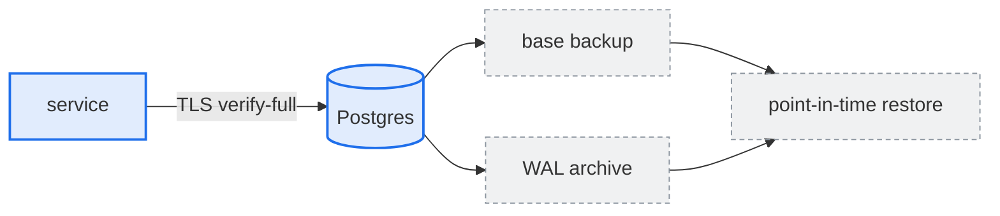

### M12 · Slice 2 — Retention & evidence PII scrubbing **[Planned]**

**Goal.** Bound how long raw evidence is kept and scrub secrets from it.
**Changes.** A retention job that prunes old occurrences/evidence; a redaction
pass over `evidence_excerpt` (tokens, URLs with creds) before persistence;
documented retention policy.
**Tests.** Redaction unit tests; a retention-prune test.
**Done when.** Evidence older than the policy is removed; known secret shapes are
redacted at write time.

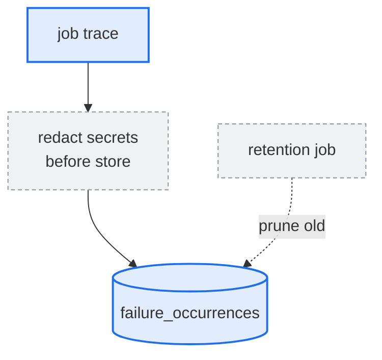

---

## M13 — Supply chain & release

Goal: scanned, signed, staged releases.

### M13 · Slice 1 — CI security gates **[Planned]**

**Goal.** Fail CI on known vulnerabilities and modernise the pipeline.
**Changes.** Add `govulncheck`, image scanning (Trivy), an `npm audit` gate, SBOM
generation, and bump GitHub Actions off deprecated Node 20 (the one current CI
warning).
**Tests.** CI itself is the test: the gates run and can fail the build.
**Done when.** A known-vulnerable dependency fails CI; no Node 20 deprecation
warning remains.

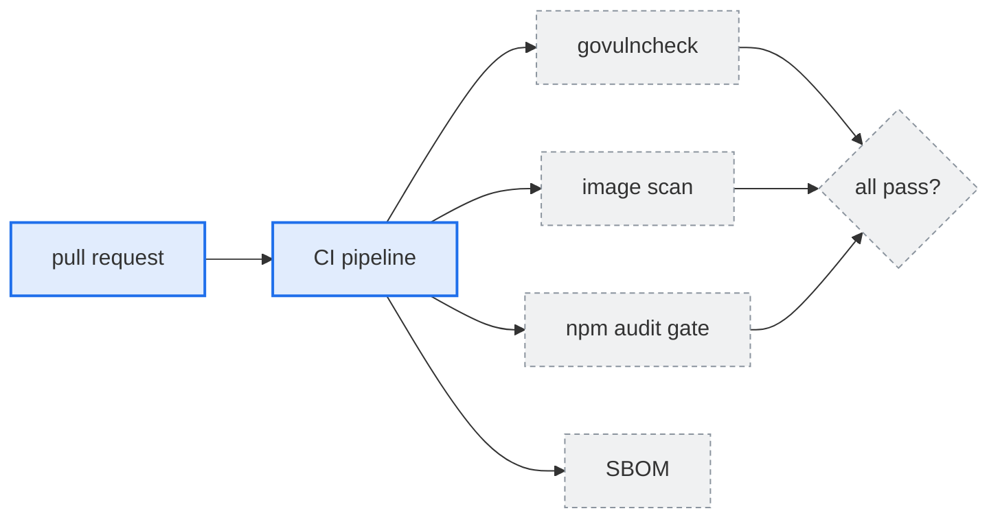

### M13 · Slice 2 — Hardened image, signing & staged rollout **[Planned]**

**Goal.** Ship a minimal, signed image through a gated environment.
**Changes.** Non-root, minimal-base Dockerfile with an image `HEALTHCHECK`; image
signing (cosign) + provenance; a staging environment with post-deploy smoke
tests and a progressive/rollback-capable rollout; add the `LICENSE` file (README
still says "to be added").
**Tests.** Smoke tests against staging; signature verification in the deploy.
**Done when.** Only signed images deploy; staging is smoke-tested before prod.

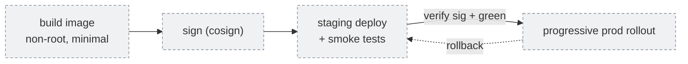

---

## M14 — Frontend production

Goal: the dashboard is authenticated and served safely.

### M14 · Slice 1 — Dashboard auth & hardened serving **[Planned]**

**Goal.** The dashboard authenticates to the API and ships with a CSP.
**Changes.** Sign-in flow that attaches the API credential (matching M6); a
configurable API base URL (replacing the dev proxy) via `VITE_*`; a strict CSP +
SRI; static hosting/CDN with cache headers.
**Tests.** Component tests for the authed fetch path and the unauthenticated
redirect; a build check that the CSP meta/config is present.
**Done when.** The dashboard only loads data when authenticated and sets a CSP in
production.

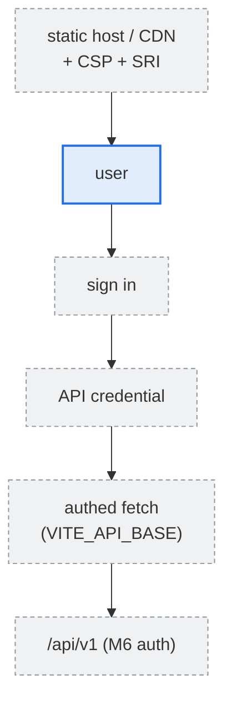

---

## Summary

19 PR-sized slices across 9 milestones. The first four milestones (M6–M9.1) are
the deployment blockers; the remaining five are hardening that can be sequenced
by risk. Each slice ships test-first, keeps the suite green, and promotes its
`[Planned]` diagram here into a `[Built]` section of
[architecture.md](architecture.md) when it lands — exactly as Milestones 0–5 were
built.

## Related documents

- [architecture.md](architecture.md) — built mechanisms (M0–M5), with diagrams
- [PROJECT_STATUS.md](../PROJECT_STATUS.md) — what is built and what is next
- [ADRs](adr/) — architecture decisions and trade-offs
